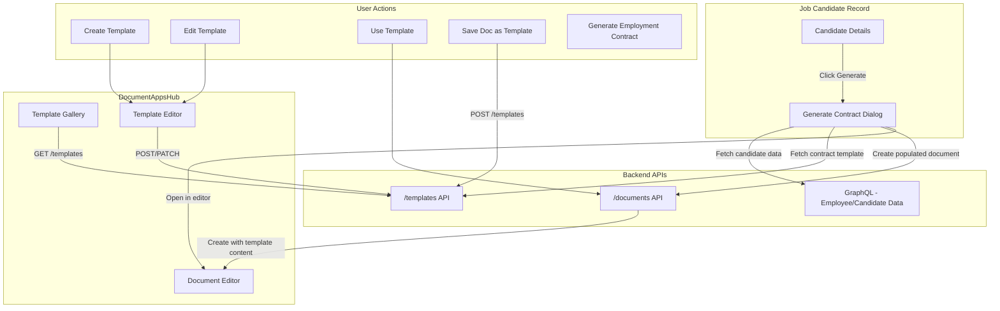

# Fix Document Templates System

## Problem Summary

1. **Templates use wrong backend**: `useDocumentTemplates.ts` uses `DocumentFileStorageService` (File Service) instead of `DocumentApiService` (document-service backend)
2. **No template editing UI**: Clicking a template creates a document from it (correct), but there's no way to view/edit/manage templates themselves
3. **"Create Template" button missing**: `onCreateTemplate` callback not passed to `TemplateGallery`
4. **No dynamic placeholder UI**: Placeholder data model exists but no UI to insert/manage them with employee data

---

## Implementation Plan

### 1. Switch Templates to Document-Service Backend

Update [`useDocumentTemplates.ts`](src/business-apps/platform/apps/document-apps/hooks/useDocumentTemplates.ts) to use `DocumentApiService` instead of `DocumentFileStorageService`:

- Replace `DocumentFileStorageService` imports with `DocumentApiService`
- Update all template operations to use API service methods:
  - `listTemplates()` -> `DocumentApiService.listTemplates()`
  - `getTemplate()` -> `DocumentApiService.getTemplate()`
  - `createTemplate()` -> `DocumentApiService.createTemplate()`
  - `deleteTemplate()` -> `DocumentApiService.deleteTemplate()`
  - `createDocumentFromTemplate()` -> `DocumentApiService.createDocumentFromTemplate()`
- Keep the built-in default templates as fallback (they're useful as starter templates)

### 2. Create Template Editor Component

Create new component [`TemplateEditor.tsx`](src/business-apps/platform/apps/document-apps/components/TemplateEditor.tsx):

- Reuse `PagedDocumentEditor` as the base editor
- Add template-specific metadata form (name, description, category, isPublic)
- Add **placeholder insertion toolbar** with:
  - "Insert Field" dropdown button
  - Categories: Employee, Address, Job, Company
  - Inserts placeholder tags like `{{employee.displayName}}`

### 3. Create Placeholder Field Picker Component

Create [`PlaceholderFieldPicker.tsx`](src/business-apps/platform/apps/document-apps/components/PlaceholderFieldPicker.tsx):

- Dropdown/dialog showing available data fields organized by category
- Employee Basic: `displayName`, `email`, `phone`, `code`, `birthDate`
- Employee Address: `addressLine`, `locality`, `postalCode`, `country`
- Job Info: `jobPosition`, `department`, `manager`, `startDate`
- Company: `companyName`, `companyAddress`
- On select, inserts `{{category.fieldName}}` at cursor position

### 4. Wire Up Template Management in Hub

Update [`DocumentAppsHub.tsx`](src/business-apps/platform/apps/document-apps/DocumentAppsHub.tsx):

- Add state for template editing mode
- Pass `onCreateTemplate` callback to `TemplateGallery`
- Add "Edit Template" option in template card actions
- Add "Save as Template" button in document editor toolbar
- Handle template save/update operations

### 5. Update TemplateGallery for Management

Update [`TemplateGallery.tsx`](src/business-apps/platform/apps/document-apps/components/TemplateGallery.tsx):

- Add edit/delete actions to template cards (for user-created templates)
- Show "Edit" button on hover for non-system templates
- Add confirmation dialog for template deletion

### 6. Implement Placeholder Substitution

Add utility for filling placeholders when creating document from template:

- Create [`placeholderUtils.ts`](src/business-apps/platform/apps/document-apps/utils/placeholderUtils.ts)
- Function to extract placeholders from template content
- Function to substitute placeholders with actual employee data
- GraphQL query to fetch employee data for substitution

### 7. Add "Generate Employment Contract" to Candidate Page

Add action button to [`JobCandidateRecord.tsx`](src/business-apps/hr/recruiting/records/job-candidate-record/JobCandidateRecord.tsx):

- Add "Generate Contract" button in the header actions area
- Create [`GenerateContractDialog.tsx`](src/business-apps/hr/recruiting/components/GenerateContractDialog.tsx):
  - Template selector dropdown (filter by category: "contracts")
  - Preview of which fields will be auto-filled
  - "Generate" button to create document
- On generate:
  1. Fetch full candidate data via GraphQL
  2. Fetch selected contract template
  3. Auto-populate placeholders with candidate data:
     - `{{candidate.firstName}}` -> candidate's first name
     - `{{candidate.lastName}}` -> candidate's last name
     - `{{candidate.displayName}}` -> full display name
     - `{{candidate.email}}` -> email address
     - `{{candidate.phone}}` -> phone number
     - `{{candidate.address}}` -> full address
     - `{{company.name}}` -> company name
     - `{{today.date}}` -> current date

  4. Create new document with populated content
  5. Navigate to document editor to review/finalize

---

## Files to Create/Modify

| File | Action |

|------|--------|

| `document-apps/hooks/useDocumentTemplates.ts` | Modify - switch to DocumentApiService |

| `document-apps/components/TemplateEditor.tsx` | Create - template editing UI |

| `document-apps/components/PlaceholderFieldPicker.tsx` | Create - field insertion UI |

| `document-apps/components/TemplateGallery.tsx` | Modify - add edit/delete actions |

| `document-apps/DocumentAppsHub.tsx` | Modify - wire up template management |

| `document-apps/utils/placeholderUtils.ts` | Create - placeholder substitution logic |

| `recruiting/records/job-candidate-record/JobCandidateRecord.tsx` | Modify - add Generate Contract button |

| `recruiting/components/GenerateContractDialog.tsx` | Create - contract generation dialog |

---

## Data Flow

