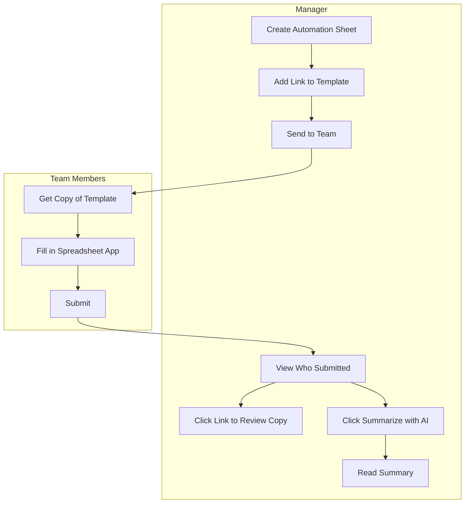
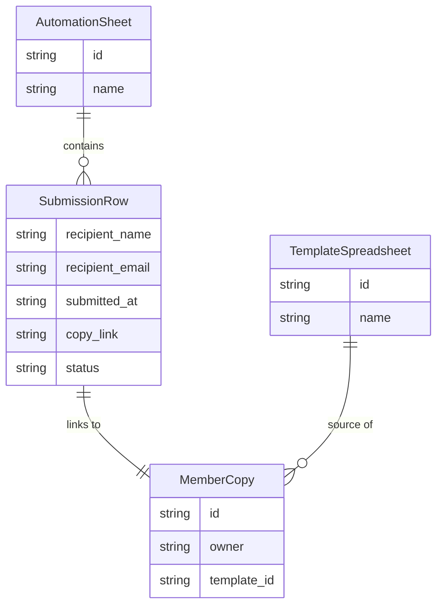
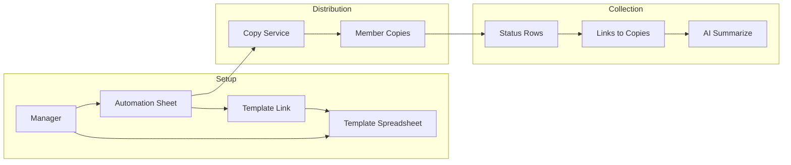

# Excel Collection Automation Feature

## Overview

Manager creates an **automation sheet** (where they see submission status) and configures it with a **link to a template** they created in the Spreadsheet App. When collection runs, each team member receives **their own copy** of the template. They fill it in directly in the Spreadsheet App — no download or upload. The automation sheet shows who submitted and links to each person's filled copy. Manager can also click **Summarize with AI** to get a summary of all submissions.

---

## Architecture

### High-Level Flow

### Two Sheets

| Sheet                | Purpose                                                                                                                                           |
| -------------------- | ------------------------------------------------------------------------------------------------------------------------------------------------- |
| **Automation Sheet** | Created by manager. Shows status: one row per team member (recipient, submitted at, link to their filled copy). This is the "report" / dashboard. |
| **Template**         | A Spreadsheet App created by the manager. Linked from the automation. Team members get a **copy** of this to fill.                                |

**No download, no upload.** Everything happens in the Spreadsheet App. Each team member gets a copy (like duplicate) of the template; they fill it in the browser and submit.

### Key Design Decisions

| Decision                    | Choice                                                                                                                                                                                                                                                                                                                      |
| --------------------------- | --------------------------------------------------------------------------------------------------------------------------------------------------------------------------------------------------------------------------------------------------------------------------------------------------------------------------- |
| **How team members submit** | **Submit button in the Spreadsheet App** — When viewing their collection copy, a "Submit" button appears in the toolbar/header. Clicking it marks the copy as submitted and updates the automation sheet. **It also completes the flow task** (the EveryBox task they received), so the task is marked done in their inbox. |
| **Where copies live**       | **Dedicated collection area** — Copies are stored in a collection-specific area and **hidden** from "All Sheets" / "My Files". The manager does NOT see 50 copies in their hub. They only see the automation sheet and template; access to copies is via links in the automation sheet.                                     |

### Data Model

**Key point:** Template is a Spreadsheet App. Each team member gets a **copy** (duplicate) of that app. The automation sheet stores one row per person with a **link to their copy**. Manager opens the link to review the full content. AI Summarize reads content from all linked copies.

### Component Flow (Technical)

---

## Implementation Strategy

**Approach:** Add automation type `excel_collection` (or `spreadsheet_collection`). The automation is tied to an **automation sheet** (where status lives) and references a **template spreadsheet** by ID/link. When started, the system creates a **copy** of the template for each recipient, shares it with them, and tracks completion. Each completed copy gets one row in the automation sheet with a link to open it.

**Key capabilities needed:**

1. **Template linking** — Automation config stores `templateSpreadsheetId` (or app ID)
2. **Copy-on-send** — Duplicate the template app for each recipient; store copies in **dedicated collection area** (hidden from All Sheets)
3. **Submit button** — In Spreadsheet App viewer: when opened as a collection copy, show "Submit" button in toolbar; on click, mark copy as submitted and update automation sheet
4. **Status sync** — Automation sheet rows updated when copies are submitted
5. **AI Summarize** — Fetch content from all submitted copies, combine, send to Prompt Manager

**Existing building blocks:**

- [SpreadsheetAppService](src/business-apps/platform/apps/spreadsheet-apps/services/SpreadsheetAppService.ts) / duplicate capability
- [SpreadsheetFileStorageService](src/business-apps/platform/apps/spreadsheet-apps/services/SpreadsheetFileStorageService.ts) — app duplication
- [useSpreadsheetAI](src/business-apps/platform/apps/spreadsheet-apps/hooks/useSpreadsheetAI.ts) — AI via Prompt Manager
- [BulkCollectionPanel](src/business-apps/platform/apps/spreadsheet-apps/components/automations/BulkCollectionPanel.tsx) — status UI pattern

---

## Phases (Revised)

### Phase 1: Types and Wizard

- Add `excel_collection` automation type
- Wizard: **Template picker** — Manager selects which spreadsheet template to send (from their existing spreadsheets)
- Automation sheet = the sheet where this automation lives; receives submission status
- Recipients + tracking columns configured in wizard

### Phase 2: Copy Creation and Distribution

- When manager starts collection: For each recipient, **duplicate** the template app
- Store copies in **dedicated collection area** (hidden from All Sheets — manager does not see 50 copies in their hub)
- Share each copy with the recipient (edit access)
- Store mapping: recipientId → copyAppId
- Notify recipient (task in EveryBox or in-app notification with link to their copy)

### Phase 3: Submit and Status

- Add **Submit button** in Spreadsheet App viewer toolbar when opened as a collection copy (context-aware)
- On Submit click:
  1. Mark copy as submitted, update automation sheet with one row (recipient, date, link to copy)
  2. **Complete the flow task** — Call flow engine to complete the task so it is marked done in EveryBox
- Automation sheet displays: Response Status table + links to open each copy (manager accesses copies only via these links)

### Phase 4: AI Summarize

- Button in automation panel when submissions exist
- Fetch content from each submitted copy (read app data for each copyAppId)
- Format and send to Prompt Manager for summary
- Display in dialog

### Phase 5: Automation Sheet Structure

- Define columns for automation sheet: `recipient_name`, `recipient_email`, `submitted_at`, `copy_link`, `status`
- Ensure automation sheet is created/configured when automation is created, or use existing sheet

---

## Open Questions

1. **Automation sheet vs. template:** Is the automation sheet a separate spreadsheet app, or a sheet within the same app as the template?
2. **Copy lifecycle:** When is a copy created — at "Start Collection" or when recipient first opens the link?
3. **Collection area implementation:** How is the dedicated collection area implemented — folder in file service, metadata flag on apps, separate index?
