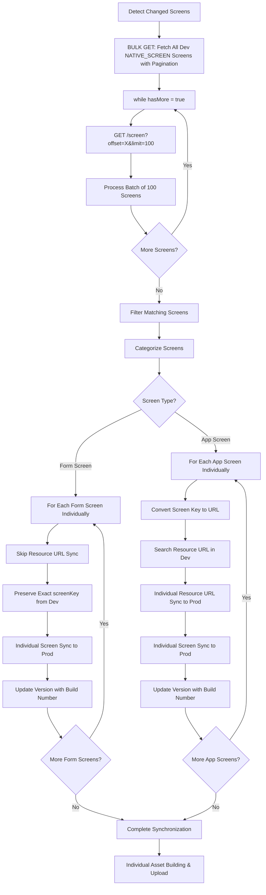

# Production Deployment - Comprehensive Screen Synchronization

## Overview

This document describes the comprehensive screen synchronization system implemented in the production deployment pipeline. The system ensures that all business app screens are properly synchronized from development to production environments, including both resource URLs and screen configurations.

## Architecture

### Components

1. **Screen Management Service**: Manages screen configurations and metadata
2. **Navigation Service**: Manages resource URLs for navigation and routing
3. **Azure Blob Storage**: Stores built screen assets
4. **Bitbucket Pipeline**: Orchestrates the deployment process

### Data Flow

```
┌─────────────────┐    ┌─────────────────┐    ┌─────────────────┐
│  Change         │    │  Comprehensive  │    │  Individual     │
│  Detection      │───▶│  Sync           │───▶│  Publishing     │
│                 │    │                 │    │                 │
└─────────────────┘    └─────────────────┘    └─────────────────┘
         │                       │                       │
         ▼                       ▼                       ▼
┌─────────────────┐    ┌─────────────────┐    ┌─────────────────┐
│  Git Analysis   │    │  Screen + URL   │    │  Asset Build    │
│  Fast-forward   │    │  Synchronization│    │  & Upload       │
│  Merge Support  │    │                 │    │                 │
└─────────────────┘    └─────────────────┘    └─────────────────┘
```

## Key Features

### 1. Change Detection (`detect-changed-screens.sh`)

**Supports Fast-Forward Merges**: The system now properly handles fast-forward merges from develop to main by:

- Detecting when running on main/master branch
- Using time-based change detection (last 24 hours)
- Falling back to recent commits analysis
- Supporting both merge commits and fast-forward merges

**Key Improvements**:

- Fixed branch detection logic to treat main as target branch
- Added production-specific merge detection
- Multiple fallback strategies for reliable change detection

### 2. Comprehensive Screen Synchronization (`handleComprehensiveScreenSync`)

This system performs **centralized screen synchronization** with **special handling for form screens**:

#### Step 1: Bulk Data Fetching (Single Efficient Operation)

- **✅ BULK GET**: Retrieves all screens with `builderType: "NATIVE_SCREEN"` from dev environment using pagination
- **✅ Pagination Loop**: Uses `while (hasMore)` loop with 100 screens per batch to handle large datasets efficiently
- **✅ Single Source**: Ensures complete coverage of all screens in one efficient data-gathering phase

#### Step 2: Filter and Categorize Matching Screens

- Compares `screen.screenComponents.formDefinition.componentPath` with changed screen paths
- Normalizes paths by removing leading slashes
- **NEW**: Separates screens into two categories:
  - **Form Screens**: `componentPath` includes `/forms/` (detected by `isFormScreen()`)
  - **App Screens**: All other screens

#### Step 3a: Individual Form Screen Processing (By Design)

For each form screen **individually**:

**Form-Specific Processing**:

- **✅ NO resource URL sync required** - forms don't need navigation entries
- **✅ Preserve exact `screenKey`** from dev environment (no path derivation)
- **✅ Maintain `builderType: "NATIVE_SCREEN"`** from dev
- **✅ Update `version`** field with current build number
- **✅ Individual screen sync** from dev to prod (one API call per screen)

**Benefits of Individual Processing**:

- **Isolation**: Each form processes independently - one failure doesn't affect others
- **Precision**: Exact control over each screen's sync process
- **Reliability**: Failed screens can be retried individually
- **Debugging**: Clear per-screen logging and error tracking

#### Step 3b: Individual App Screen Processing (By Design)

For each app screen **individually**:

**App-Specific Processing**:

- **🔗 Resource URL conversion**: Converts screen key to platform URL using pattern: `url_path1~path2~path3` → `/platform/path1/path2/path3`
- **🔍 Resource URL search**: Searches for corresponding resource URL in dev environment
- **🔄 Individual resource URL sync**: Syncs resource URL to production with **same ID** as dev
- **📱 Individual screen sync**: Syncs complete screen configuration from dev to prod
- **📝 Version update**: Updates version information with build number

**Benefits of Individual Processing**:

- **Fault Tolerance**: One screen's resource URL issues don't break other screens
- **Granular Control**: Each screen can have different sync strategies
- **Clear Progress**: Detailed logging per screen for troubleshooting
- **Flexibility**: Different handling for different screen types

### 3. ID Preservation

**Critical Feature**: The system preserves IDs between dev and prod environments:

- Resource URLs maintain the same UUID across environments
- Screen configurations use consistent identifiers
- Ensures data integrity and prevents orphaned references

## Implementation Details

### New Functions in `api-client.js`

#### `getAllNativeScreens(apiEndpoint, oauthConfig)`

- Fetches all NATIVE_SCREEN screens with pagination
- Handles large datasets efficiently
- Returns complete screen objects with metadata

#### `convertScreenKeyToUrl(screenKey)`

- Converts screen keys to platform URLs
- Pattern: `url_path1~path2~path3` → `/platform/path1/path2/path3`
- Handles malformed keys gracefully

#### `syncResourceUrlWithSameId(devResourceUrl, prodApi, prodConfig)`

- Syncs resource URLs maintaining same ID
- Checks for existing URLs to prevent duplicates
- Preserves all resource metadata and properties

#### `syncScreenFromDevToProd(devScreen, prodApi, prodConfig, buildVersion)`

- Syncs complete screen configurations
- Updates version information
- Handles both create and update operations

### Environment Variables

**Production Environment**:

- `SCREEN_MANAGEMENT_SERVICE_API_PROD`: Production screen management endpoint
- `NAVIGATION_SERVICE_API_PROD`: Production navigation service endpoint
- `OAUTH_CLIENT_ID_PROD`: Production OAuth client ID
- `OAUTH_CLIENT_SECRET_PROD`: Production OAuth secret
- `OAUTH_URL_PROD`: Production OAuth server URL
- `OAUTH_REALM_PROD`: Production OAuth realm

**Development Environment**:

- `NEXT_PUBLIC_SCREEN_MANAGEMENT_SERVICE_API`: Dev screen management endpoint
- `NEXT_PUBLIC_NAVIGATION_SERVICE_API`: Dev navigation service endpoint
- `OAUTH_CLIENT_ID`: Dev OAuth client ID
- `OAUTH_CLIENT_SECRET`: Dev OAuth secret

### Process Flow



## Benefits

### 1. **Optimal Data Fetching Strategy**

- **Single bulk GET operation** with pagination reduces initial API overhead
- **Efficient pagination**: `while (hasMore)` loop handles datasets of any size
- **Complete data coverage**: Ensures all NATIVE_SCREEN screens are retrieved
- **Memory efficient**: Processes screens in 100-item batches

### 2. **Individual Processing Advantages**

- **Fault isolation**: One screen failure doesn't affect others
- **Granular control**: Each screen can have different sync strategies
- **Clear debugging**: Per-screen logging and error tracking
- **Retry capability**: Failed screens can be individually retried
- **Progress visibility**: Real-time status updates per screen

### 3. **Reliability Through Isolation**

- **Non-blocking failures**: Screen sync failures don't stop other screens
- **Independent operations**: Each screen's build/sync is self-contained
- **Detailed error reporting**: Specific failure reasons per screen
- **Selective recovery**: Only failed screens need to be reprocessed

## Error Handling

### Graceful Individual Processing

- **Per-screen isolation**: Individual screen failures don't affect others
- **Detailed per-screen logging**: Specific error context for each screen
- **Continue on failure**: Processing continues with remaining screens
- **Comprehensive error reporting**: All failures collected and reported at end

### Recovery Mechanisms

- **Individual retry logic**: Failed screens can be retried independently
- **Fallback to asset-only publishing**: If sync fails, asset building still continues
- **Clear error categorization**: Sync failures vs build failures vs upload failures
- **Pipeline-friendly reporting**: Appropriate exit codes for CI/CD integration

## Monitoring and Logging

### Comprehensive Individual Processing Reports

```
📊 PRODUCTION PUBLISHING SUMMARY
🔢 Build number: 1234
🎯 Publish version: 1234
🔗 Resource URL sync: ENABLED
📈 Total screens processed: 5
✅ Successfully published: 5
❌ Failed: 0

🔄 CENTRALIZED SYNC RESULTS:
   📋 Total screens processed: 5
   📝 Form screens synced individually: 2 (no resource URL sync)
   📱 App screens synced individually: 3 (with resource URL sync)
   🔗 Resource URLs synced individually: 3
   📱 Total screen configs synced: 5

🔨 INDIVIDUAL ASSET BUILDING:
   📦 Screens built successfully: 5
   ☁️ Screens uploaded to Azure: 5
   ❌ Build/upload failures: 0
```

### Detailed Per-Screen Logging

- **Individual screen progress**: Each screen reports its own status
- **Clear success/failure indicators**: Per-screen result reporting
- **Performance metrics**: Build time and sync time per screen
- **Resource-specific tracking**: Which screens had resource URLs, which didn't

## Future Enhancements

### Individual Processing Optimizations

1. **Parallel Screen Processing**: Process multiple screens simultaneously (within rate limits)
2. **Smart Retry Logic**: Exponential backoff for failed individual screen operations
3. **Pre-sync Validation**: Validate each screen before attempting sync
4. **Conditional Updates**: Only update screens when actual changes are detected
5. **Progress Persistence**: Save progress to resume from failed screens

### Data Fetching Improvements

1. **Smarter Pagination**: Dynamic batch sizes based on API performance
2. **Caching Strategy**: Cache dev screen data for multiple deployment runs
3. **Filtered Initial Fetch**: Only fetch screens that might match change patterns
4. **Parallel Data Fetching**: Fetch dev screens and resource URLs simultaneously

### Enhanced Individual Monitoring

1. **Per-Screen Metrics**: Detailed timing and success rates per screen type
2. **Historical Tracking**: Track screen deployment history and patterns
3. **Predictive Failures**: Identify screens likely to fail based on history
4. **Real-time Dashboard**: Live view of individual screen processing status

### Configuration Options

- **Processing concurrency**: Number of screens to process simultaneously
- **Timeout settings**: Per-screen operation timeouts
- **Retry policies**: Individual screen retry strategies
- **Filtering rules**: Custom screen matching and exclusion rules

## Troubleshooting

### Common Issues

**No screens found to sync**:

- Check changed screen detection
- Verify screen paths in dev environment
- Confirm NATIVE_SCREEN filter is working

**Resource URL sync failures**:

- Verify navigation service connectivity
- Check OAuth credentials
- Validate resource URL format

**Screen sync failures**:

- Check screen management service availability
- Verify screen configuration format
- Validate required fields

### Debug Steps

1. Check pipeline logs for detailed error messages
2. Verify environment variables are set correctly
3. Test individual API endpoints manually
4. Check OAuth token validity
5. Validate screen and resource URL data format

## Security Considerations

### Authentication

- OAuth 2.0 client credentials flow
- Separate credentials for dev and prod environments
- Token caching with expiration handling

### Data Protection

- No sensitive data in logs
- Secure credential storage
- Environment separation

### Access Control

- Service-to-service authentication only
- No user credentials in automation
- Minimal required permissions

---

_This documentation is maintained alongside the production deployment system and should be updated when changes are made to the synchronization process._
