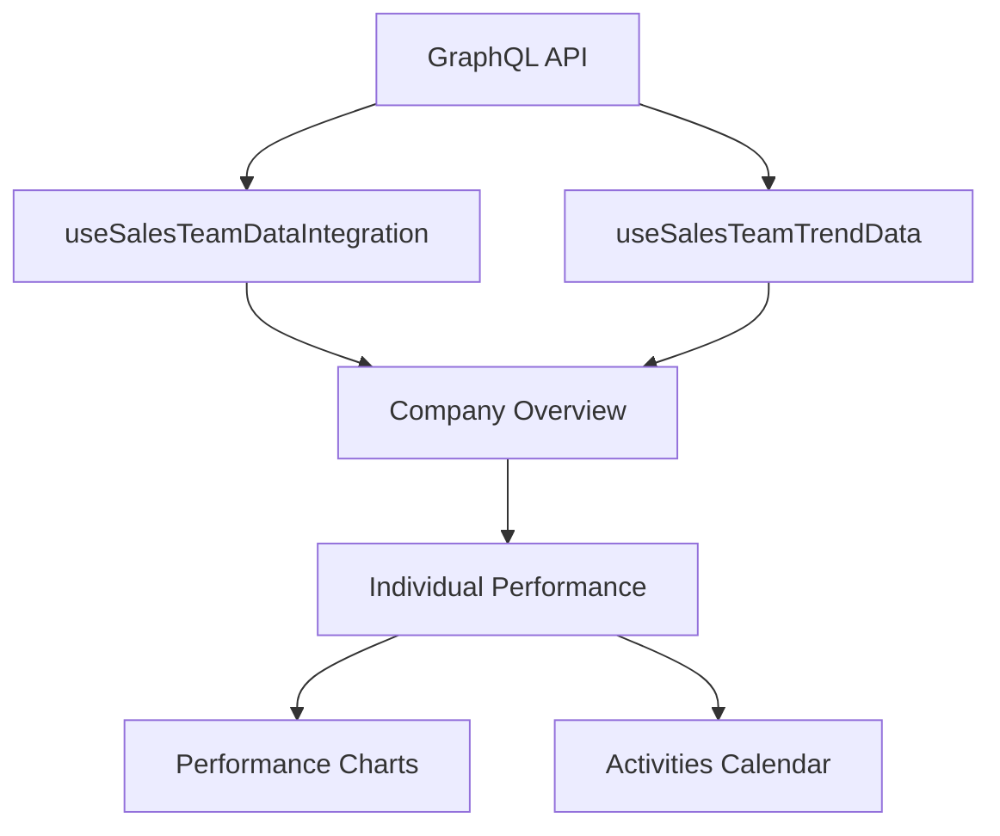

# Sales Performance App Enhancement Requirements

**Version:** 1.0  
**Date:** December 2024  
**Project:** Enhanced Sales Team Performance Analysis System

---

## 📊 Executive Summary

The Sales Performance app serves as a performance analysis tool for both direct managers and C-level executives. This document outlines the requirements to enhance the current system to support hierarchical team management, cross-team comparisons, and role-based access controls.

### Current State

- ✅ Company-level overview with real-time KPIs
- ✅ Individual performance drill-down capabilities
- ✅ Activities calendar and performance charts
- ✅ Real GraphQL API integration

### Target State

- 🎯 Three-tier hierarchy: Company → Team → Individual
- 🎯 Role-based views (CEO vs Team Manager)
- 🎯 Cross-team comparison capabilities
- 🎯 Contextual KPI comparisons (team vs company)

---

## 🎯 Business Requirements

### User Stories

#### As a CEO/C-Level Executive:

- **I want to** compare KPIs across different sales teams **so that** I can identify high and low performing teams
- **I want to** drill down from company → team → individual levels **so that** I can investigate performance issues
- **I want to** see company-wide trends and benchmarks **so that** I can make strategic decisions
- **I want to** access all teams' performance data **so that** I can get a complete organizational view

#### As a Sales Team Manager:

- **I want to** see my team's performance compared to company averages **so that** I can understand our relative position
- **I want to** compare individual team members **so that** I can identify coaching opportunities
- **I want to** access team activities calendar **so that** I can monitor daily execution
- **I want to** see team trends over time **so that** I can track improvement

#### As an Individual Sales Representative:

- **I want to** see my performance compared to both team and company averages **so that** I understand my standing
- **I want to** access detailed activity tracking **so that** I can optimize my daily work
- **I want to** view my personal trends and goals **so that** I can track progress

---

## 🏗️ Technical Analysis

### Current System Architecture

#### Existing Components

```
📁 SalesTeamPerformanceOverview.tsx (Main entry point)
├── 📊 WidgetGroup (Company KPIs)
├── 📋 SalesTeamMembersList (Individual list)
└── 👤 SalesMemberPerformance (Individual detail)
    ├── 📈 SalesPerformanceTab (Stats + Charts)
    └── 📅 SalesActivitiesTab (Activities + Calendar)
```

#### Current Data Flow



#### Existing Assets to Leverage

- ✅ **Real-time GraphQL integration** (`useSalesTeamDataIntegration`, `useSalesTeamTrendData`)
- ✅ **Modern UI components** (`@newwork/nw-design-system`)
- ✅ **Performance charts** (`PerformanceTrendsChart` with recharts)
- ✅ **Activities calendar** (`ActivitiesCalendar`)
- ✅ **KPI widgets** (`WidgetGroup` component)
- ✅ **Search/filtering** (`DataContainer`, `DebouncedInput`)
- ✅ **URL-based navigation** (employee ID routing)

---

## 🎨 Enhanced System Design

### New Navigation Hierarchy

```
📊 Sales Performance Dashboard
├── 🏢 Company Overview (CEO/C-Level View)
│   ├── Cross-Team Comparison Charts
│   ├── Company-wide KPIs & Trends
│   ├── Team Performance Ranking
│   └── Team Selection for Drill-down
│
├── 👥 Team [X] Overview (Team Manager View)
│   ├── Team KPIs vs Company Benchmarks
│   ├── Team Performance Graphs
│   ├── Team Member List & Comparison
│   ├── Team Activities Calendar
│   └── Individual Selection for Drill-down
│
└── 👤 Individual [Y] Performance (Enhanced)
    ├── Individual KPIs vs Team & Company
    ├── Personal Performance Trends
    ├── Activities List & Calendar
    └── Entities Managed (Leads, Contacts, etc.)
```

### Role-Based Access Matrix

| Feature             | CEO/C-Level | Team Manager      | Individual    |
| ------------------- | ----------- | ----------------- | ------------- |
| View all teams      | ✅          | ❌                | ❌            |
| Compare teams       | ✅          | ❌                | ❌            |
| Team performance    | ✅          | ✅ (own team)     | ❌            |
| Individual detail   | ✅          | ✅ (team members) | ✅ (self)     |
| Activities calendar | ✅ (all)    | ✅ (team)         | ✅ (personal) |
| Export data         | ✅          | ✅                | ✅            |

---

## 🔧 Implementation Requirements

### Phase 1: Team Structure Integration (4-6 weeks)

#### 1.1 Organizational Data Integration

- **Extend existing hooks** to include team/organizational unit data
- **Leverage** `BusinessAppContextProps.userInfo.employeeDetails.organizationalUnit`
- **Integrate** with teammates API (`useTeammates` hook)
- **Add role detection** based on user permissions

#### 1.2 Navigation Enhancement

```typescript
// Enhanced URL routing structure
/sales-performance                    // Company overview
/sales-performance?teamId={id}       // Team overview
/sales-performance?teamId={id}&employeeId={id}  // Individual
```

#### 1.3 Enhanced Components

```typescript
// New component: TeamSelector
interface TeamSelectorProps {
  availableTeams: Team[]
  selectedTeam?: Team
  onTeamSelect: (team: Team) => void
  userRole: 'ceo' | 'manager' | 'individual'
}

// Enhanced component: ContextualKPIWidgets
interface ContextualKPIWidgetsProps {
  data: KPIData
  context: 'company' | 'team' | 'individual'
  comparisonData?: KPIData // For benchmarking
}
```

### Phase 2: Team-Level Analytics (3-4 weeks)

#### 2.1 Team Performance View

- **Create** `TeamPerformanceOverview` component
- **Extend** existing KPI calculations for team-level metrics
- **Add** team vs company comparison logic
- **Implement** team member performance ranking

#### 2.2 Team Activities Integration

- **Extend** `ActivitiesCalendar` for team aggregation
- **Add** team activity distribution charts
- **Implement** team activity goals vs actual tracking

#### 2.3 Data Hooks Enhancement

```typescript
// New hooks needed
useTeamPerformanceData(teamId: string, accessToken: string)
useTeamComparison(teamIds: string[], accessToken: string)
useTeamActivities(teamId: string, accessToken: string)
useOrganizationalStructure(accessToken: string)
```

### Phase 3: Cross-Team Comparison (3-4 weeks)

#### 3.1 Team Comparison Dashboard

- **Create** `TeamComparisonDashboard` component
- **Build** side-by-side team performance cards
- **Implement** performance ranking tables
- **Add** cross-team trend analysis

#### 3.2 Advanced Analytics

- **Performance ranking algorithms**
- **Team performance scoring system**
- **Benchmarking calculations**
- **Export/reporting capabilities**

---

## 📋 Detailed Component Specifications

### 1. Enhanced SalesTeamPerformanceOverview

#### Current State

- Single company overview with member list
- Direct navigation to individual performance
- Basic KPI widgets and member table

#### Enhanced State

```typescript
interface EnhancedSalesTeamPerformanceOverviewProps extends BusinessAppContextProps {
  viewMode: 'company' | 'team' | 'individual'
  selectedTeamId?: string
  selectedEmployeeId?: string
  userRole: 'ceo' | 'manager' | 'individual'
}
```

#### New Features

- Role-based rendering logic
- Team selection capability
- Breadcrumb navigation
- Context-aware KPI display

### 2. New TeamPerformanceOverview Component

```typescript
interface TeamPerformanceOverviewProps extends BusinessAppContextProps {
  teamId: string
  comparisonContext: 'company' | 'other-teams'
}

// Features:
// - Team KPI widgets with company comparison
// - Team member performance table
// - Team activities calendar
// - Team performance trends chart
// - Navigation to individual performance
```

### 3. Enhanced Individual Performance

#### New Context Indicators

- Performance vs team average
- Performance vs company average
- Team ranking position
- Improvement suggestions

### 4. New TeamComparisonDashboard Component

```typescript
interface TeamComparisonDashboardProps extends BusinessAppContextProps {
  selectedTeams: Team[]
  comparisonMetrics: string[]
  timeRange: TimeRange
}

// Features:
// - Multi-team KPI comparison
// - Performance ranking table
// - Trend comparison charts
// - Team selection interface
```

---

## 🎨 UI/UX Specifications

### Design System Compliance

- **Use** `@newwork/nw-design-system` components exclusively
- **Follow** existing component patterns (`WidgetGroup`, `DataContainer`)
- **Maintain** consistent styling with `gba:` prefixed classes
- **Implement** proper loading/error states

### Navigation Patterns

- **Breadcrumb navigation**: Company → Team X → Person Y
- **Tab-based switching** between performance/activities views
- **URL state preservation** for bookmarking and sharing
- **Back button support** for smooth navigation

### Visual Hierarchy

- **Company level**: High-level KPIs, team comparison charts
- **Team level**: Team KPIs with context, member comparison
- **Individual level**: Personal metrics with team/company context

### Responsive Design

- **Mobile-first** approach for all new components
- **Progressive disclosure** for complex data
- **Touch-friendly** controls for mobile users

---

## 📊 Data Requirements

### New GraphQL Queries Needed

#### Team Structure Queries

```graphql
query GetOrganizationalTeams($accessToken: String!) {
  teams {
    id
    name
    managerId
    members {
      employeeId
      name
      role
    }
  }
}
```

#### Team Performance Queries

```graphql
query GetTeamPerformanceData(
  $teamId: String!,
  $timeRange: TimeRange!,
  $accessToken: String!
) {
  teamPerformance(teamId: $teamId, timeRange: $timeRange) {
    totalRevenue
    averageWinRate
    totalActivities
    pipelineValue
    memberCount
    trends {
      // ... trend data
    }
  }
}
```

#### Cross-Team Comparison Queries

```graphql
query GetTeamComparison($teamIds: [String!]!, $metrics: [String!]!, $accessToken: String!) {
  teamComparison(teamIds: $teamIds, metrics: $metrics) {
    teamId
    teamName
    metrics {
      name
      value
      trend
      ranking
    }
  }
}
```

### Data Transformation Requirements

- **Team aggregation logic** for individual metrics
- **Comparison calculation algorithms** (percentile rankings)
- **Trend analysis** for team performance over time
- **Benchmarking calculations** (team vs company averages)

---

## 🔒 Security & Permissions

### Role-Based Access Control

- **CEO/C-Level**: Access to all teams and cross-team comparisons
- **Team Manager**: Access to own team data only
- **Individual**: Access to personal data and team context

### Data Security

- **Employee data filtering** based on organizational hierarchy
- **API endpoint protection** with role validation
- **Sensitive data masking** for unauthorized viewers

### Permission Integration

- **Leverage** existing `usePermissionCheck` hook
- **Extend** `BusinessAppContextProps` for role detection
- **Implement** component-level access controls

---

## 🧪 Testing Strategy

### Unit Testing

- **Component rendering** with different role contexts
- **Data hook functionality** with mocked GraphQL responses
- **Permission logic** validation
- **Navigation state management**

### Integration Testing

- **End-to-end user flows** for each role type
- **Cross-component navigation** testing
- **API integration** validation
- **Performance testing** with large datasets

### User Acceptance Testing

- **Role-based workflow** validation
- **Performance comparison** accuracy
- **UI/UX feedback** from actual users
- **Mobile responsiveness** testing

---

## 📈 Success Metrics

### User Engagement

- **Navigation depth**: Average levels accessed per session
- **Time spent**: Average session duration by role
- **Feature adoption**: Usage of comparison features
- **User satisfaction**: Post-implementation surveys

### System Performance

- **Load times**: Page load performance metrics
- **API response times**: GraphQL query performance
- **Error rates**: System reliability metrics
- **Mobile usage**: Mobile vs desktop engagement

### Business Impact

- **Decision speed**: Faster performance issue identification
- **Team performance**: Improvement in team metrics
- **Manager efficiency**: Time saved in performance analysis
- **Strategic insights**: Quality of executive reporting

---

## 🗓️ Implementation Timeline

### Phase 1: Foundation (Weeks 1-6)

- **Week 1-2**: Team structure integration and role detection
- **Week 3-4**: Enhanced navigation and URL routing
- **Week 5-6**: Basic team selection and contextual KPIs

### Phase 2: Team Analytics (Weeks 7-10)

- **Week 7-8**: Team performance view and data integration
- **Week 9-10**: Team activities calendar and member comparison

### Phase 3: Advanced Features (Weeks 11-14)

- **Week 11-12**: Cross-team comparison dashboard
- **Week 13-14**: Advanced analytics and reporting

### Phase 4: Polish & Testing (Weeks 15-16)

- **Week 15**: Final UI/UX polish and performance optimization
- **Week 16**: Comprehensive testing and deployment preparation

---

## 💰 Resource Requirements

### Development Team

- **1 Senior Frontend Developer** (React/TypeScript)
- **1 Backend Developer** (GraphQL/API development)
- **1 UI/UX Designer** (Part-time for design refinements)
- **1 QA Engineer** (Testing and validation)

### Infrastructure

- **GraphQL API enhancements** for team structure queries
- **Additional database indexing** for performance optimization
- **Monitoring and analytics** for success metrics tracking

---

## 🚀 Getting Started

### Prerequisites

- Current sales performance system codebase
- Access to organizational structure APIs
- GraphQL endpoint with team data capabilities
- `@newwork/nw-design-system` components

### First Steps

1. **Set up development branch** from current sales performance code
2. **Review existing components** and identify reusable patterns
3. **Design team structure API** integration approach
4. **Create basic team selection interface**
5. **Implement role-based rendering logic**

---

## 📚 Appendix

### Related Documentation

- Current Sales Performance System Architecture
- GraphQL API Documentation
- Design System Component Library
- Organizational Structure API Documentation

### Glossary

- **CEO View**: Company-wide perspective with all teams visible
- **Team Manager View**: Single team focus with company context
- **Individual View**: Personal performance with team/company benchmarks
- **Cross-Team Comparison**: Side-by-side team performance analysis
- **Contextual KPIs**: Metrics displayed with relevant comparison data

---

_This document serves as the comprehensive requirements specification for enhancing the Sales Performance App with multi-level team management and role-based analytics capabilities._
