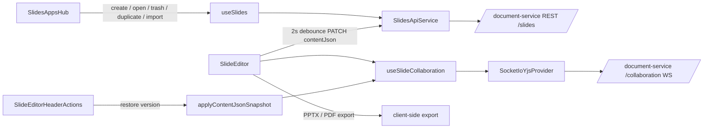
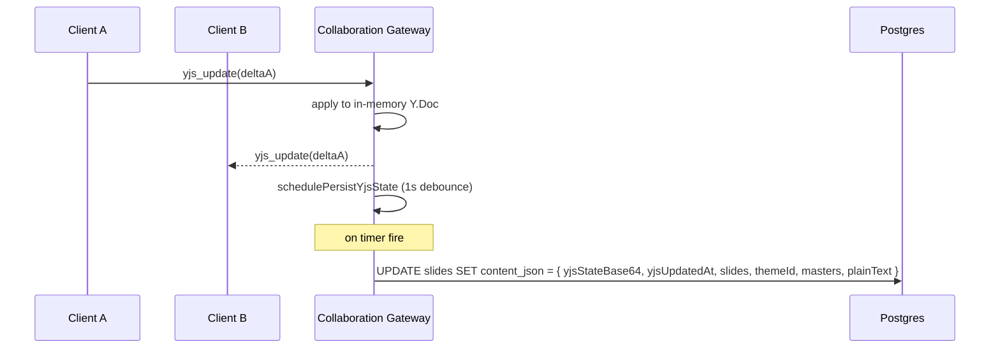
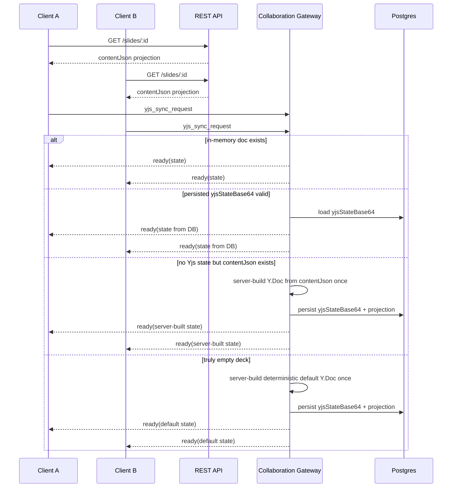
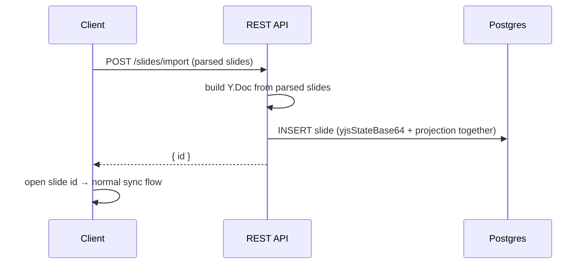
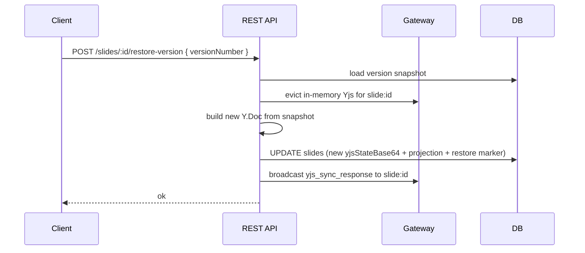
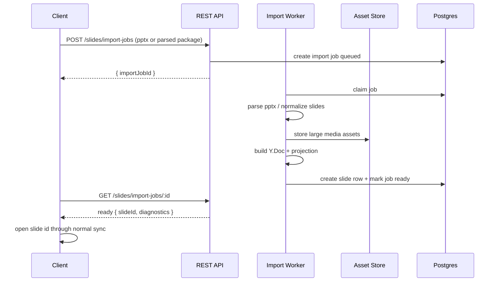
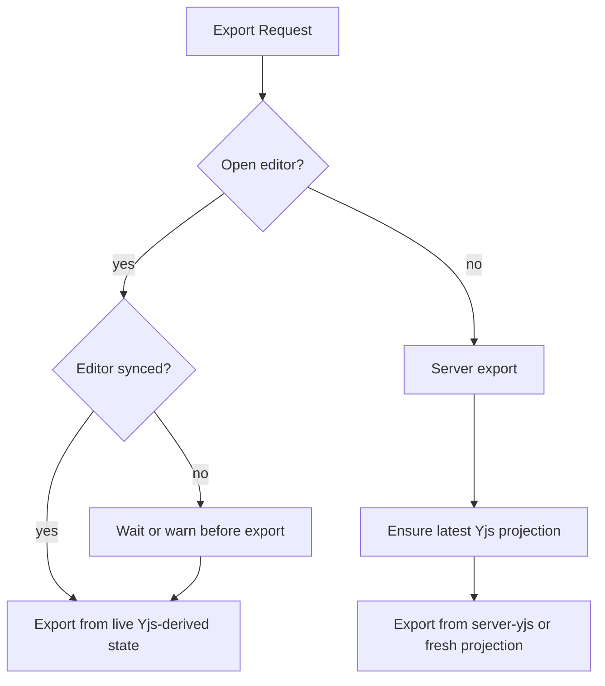

# Slides — Collaboration And Persistence Rework Plan

Owner: Office / Slides
Status: Draft proposal
Related files:

- Frontend (gravity-business-apps2):
  - `src/business-apps/platform/apps/slide-apps/SlidesAppsHub.tsx`
  - `src/business-apps/platform/apps/slide-apps/components/SlideEditor.tsx`
  - `src/business-apps/platform/apps/slide-apps/hooks/useSlides.ts`
  - `src/business-apps/platform/apps/slide-apps/hooks/useSlideCollaboration.ts`
  - `src/business-apps/platform/apps/slide-apps/services/SlidesApiService.ts`
  - `src/business-apps/platform/apps/shared/services/SocketIoYjsProvider.ts`
  - `src/business-apps/platform/apps/shared/services/CollaborationClient.ts`
- Backend (document-service):
  - `src/slides/slides.controller.ts`
  - `src/slides/slides.service.ts`
  - `src/slides/slide-yjs-state.util.ts`
  - `src/slides/slide-html.service.ts`
  - `src/collaboration/collaboration.gateway.ts`

## 1. Context

Slides today is a hybrid system. Clients edit through Yjs over Socket.IO for real-time collaboration, but the same `contentJson` field in Postgres is also written by clients via REST `PATCH /slides/:id` on a 2-second debounce. The backend further synthesizes a Yjs snapshot from JSON on every REST write. Viewer surfaces (HTML export, `slide-count`, version snapshots) read from the JSON array only. This produces several classes of bugs that the team has been observing:

1. Live editor state (Yjs) and the JSON projection (`contentJson.slides` / `themeId` / `masters`) can diverge.
2. Remote-only editors never trigger their client's REST snapshot, so the persisted JSON can lag the authoritative Yjs CRDT.
3. On `PATCH /slides/:id` with `contentJson`, the backend recomputes a Yjs snapshot via `withGeneratedSlideYjsSnapshot`, which can overwrite in-memory collaborative state on the next sync.
4. Import/new/template flows race the client bootstrap: one peer can win with a stale/empty Yjs state.
5. Export to HTML reads `contentJson.slides` which may be stale relative to current collaborative state.
6. Version restore rewrites Yjs from a historical JSON snapshot, which is correct in intent but has no server-side ceremony (no version bump of the CRDT, no clearing in-memory caches across peers).

This plan outlines a move to a clean model where **the collaborative Yjs document is the sole write authority for slide content**, and the JSON/HTML projections are **server-derived read models**. Deck-level CRUD, sharing, import entry, and version bookkeeping stay over REST.

## 2. Current state (verified)

### 2.1 Frontend — data flow

Observations:

- `SlideEditor` initializes `useSlideCollaboration` with `initialSlides` / `initialThemeId` derived from `slide.contentJson`. These are only used for bootstrap if the server has no Yjs state.
- Every mutation (`updateCollaborativeSlides`, `updateCollaborativeElement`, `addCollaborativeSlide`, `updateCollaborativeMasters`, theme change, undo/redo, paste, duplicate, reorder, AI refine/generate, template import) routes through the Yjs mutators in `useSlideCollaboration`, which are the real write path while collaboration is on.
- On each local Yjs update, `SlideEditor.scheduleSnapshotSave` debounces 2 seconds, then calls `SlidesApiService.updateSlide(slideId, { contentJson })` with `slides`, `themeId`, and optionally `masters`. Remote-only edits never trigger this on the remote client.
- `handleSave` (manual "Save Now") performs the same PATCH immediately.
- Export to PPTX/PDF reads the in-memory `slides` array / theme from the editor, not from the backend.
- Version restore pulls `contentJson` from `/versions/slide/:id/:version`, then calls `applyContentJsonSnapshot` which replays the JSON into the local Yjs doc. CRDT-wise that is a full replacement of the `slides` array.

### 2.2 Backend — data flow

- `POST /slides` and `PATCH /slides/:id` in `SlidesService.create` / `update` call `withGeneratedSlideYjsSnapshot(contentJson)`. If the client did not send `yjsStateBase64`, the server rebuilds a fresh Yjs binary from `contentJson.slides` / `themeId` / `masters`. If the client already sent `yjsStateBase64` it is preserved. `plainText` is only updated when `content` is explicitly present in the DTO.
- The collaboration gateway (namespace `/collaboration`, `maxHttpBufferSize: 50MB`) keeps one in-memory `Y.Doc` per `slide:<id>`.
  - `yjs_sync_request`: if already bootstrapped in memory → return `status: 'ready'` with current state. If not, apply persisted `yjsStateBase64` from `contentJson`; if absent or inconsistent with stored `slides`, elect one initializer with `status: 'bootstrap'`.
  - `yjs_bootstrap`: accepts the initializer's encoded state; rejects empty bootstraps when `contentJson.slides.length > 0` (guard against empty-deck poisoning).
  - `yjs_update`: applies and fan-outs to peers, then `schedulePersistYjsState` (1s debounce). Persist merges `{ ...contentJson, yjsStateBase64, yjsUpdatedAt }` back to DB via `slidesService.update` with `createVersion: false`.
  - On disconnect: last member in the room flushes and destroys the in-memory state.
  - Idle (> 10 min no subscribers): evict with final persist.
  - External-update detection: if `entity.updatedAt - yjsUpdatedAt > 5s` on sync, evict in-memory state and re-bootstrap.
- `GET /slides/:id/html` and `GET /slides/:id/slide-count` read `contentJson.slides` via `SlideHtmlService`. They never touch the Yjs binary.
- Versions: `/versions` stores `contentSnapshot = { title, description, content, contentJson, settings }`. Restore is UI-driven on the client.

### 2.3 Operation inventory

| Operation                 | Today's authority                                                              | Notes                                                                                                                                                                          |
| ------------------------- | ------------------------------------------------------------------------------ | ------------------------------------------------------------------------------------------------------------------------------------------------------------------------------ |
| New deck                  | REST `POST /slides`                                                            | Empty `contentJson`; server synthesizes empty Yjs snapshot. Editor mounts and bootstraps.                                                                                      |
| New from template         | REST create, then client seeds Yjs via `updateCollaborativeSlides`             | Depends on collaboration being synced before `updateCollaborativeSlides` runs (`initialTemplateAppliedRef`).                                                                   |
| Import PPTX               | Client parse → REST create → REST PATCH `contentJson`                          | Two round trips. Editor later opens and Yjs hydrates from the just-written JSON.                                                                                               |
| Open                      | REST `GET /slides/:id` for metadata + initial JSON; Yjs sync for live state    | Two sources hydrate the editor.                                                                                                                                                |
| Edit (all)                | Yjs over WS                                                                    | Plus 2s REST PATCH of JSON projection from each local editor.                                                                                                                  |
| Autosave                  | 2s debounced REST PATCH (client) + 1s debounced Yjs persist (server)           | Two independent persistence clocks.                                                                                                                                            |
| Explicit save             | REST PATCH                                                                     | Same payload as autosave.                                                                                                                                                      |
| Delete                    | REST `DELETE /slides/:id` (soft)                                               | Gateway skips persist for trashed decks.                                                                                                                                       |
| Restore from trash        | Drive service restore + REST GET                                               | Reopens editor which triggers new Yjs sync.                                                                                                                                    |
| Duplicate                 | REST `POST /slides/:id/duplicate`                                              | Server copies `contentJson`. Duplicate does not create a new Yjs room implicitly; the copy relies on `withGeneratedSlideYjsSnapshot` being re-run on the copy's `contentJson`. |
| PPTX export               | Client-side from in-memory `slides`                                            | No server endpoint.                                                                                                                                                            |
| PDF export                | Client-side via hidden renderer                                                | No server endpoint.                                                                                                                                                            |
| HTML export / slide-count | Server-side from `contentJson.slides`                                          | Diverges if JSON projection is stale.                                                                                                                                          |
| Version create            | Client invocation (checkpoint dialog); payload = current `contentJson`         | Autosave versioning disabled by UI flag.                                                                                                                                       |
| Version restore           | Client GET snapshot → `applyContentJsonSnapshot` → replaces Yjs `slides` array | Peers see a large CRDT update, but no server-side versioning ceremony.                                                                                                         |

### 2.4 Simultaneous open / bootstrap election today

When two users enter the same slide deck at almost the same time and there is no usable in-memory Yjs document yet, the backend acts as a bootstrap coordinator:

1. Both clients first load the slide entity over REST, so each browser has a local `contentJson.slides` snapshot available for pre-sync rendering and potential bootstrap.
2. Each client connects to `/collaboration`, joins `slide:<id>`, and sends `yjs_sync_request`.
3. The first request that finds no bootstrapped in-memory doc and no valid persisted `contentJson.yjsStateBase64` becomes the initializer. The gateway stores that socket id in `bootstrapperSocketId` and returns `status: 'bootstrap', role: 'initializer'`.
4. Any near-simultaneous second client sees `isBootstrapping === true`, receives `status: 'waiting'`, and retries after the client-side retry delay.
5. The initializer runs `onBootstrapRequired` in `useSlideCollaboration`, seeds the local `Y.Doc` from its REST-loaded `initialSlides` / `initialThemeId`, then sends `yjs_bootstrap`.
6. The gateway rejects `yjs_bootstrap` from any socket other than `bootstrapperSocketId`.
7. On successful bootstrap, the gateway marks the room bootstrapped, broadcasts `yjs_sync_response` to everyone in the room, and asynchronously persists the Yjs state.
8. If the initializer disappears or never completes, the gateway resets bootstrap state after 30 seconds, allowing a later client to become initializer.

This protects against two clients seeding at the same time, but it still has a weak point: the winner is an arbitrary browser using whatever REST snapshot it loaded. If that snapshot is stale or empty, the room can be seeded from the wrong source. The target architecture removes that browser-election path for normal decks by creating or repairing the canonical Yjs document on the server before returning `ready(state)`.

## 3. Identified risk scenarios (reproduce checklist)

These are the concrete scenarios the rework must fix. Each should be made a regression test.

1. **Divergent JSON vs Yjs**. Two users edit. User A makes many small edits and then closes the tab. User B never edits, only views. After B closes and someone re-opens later, `contentJson.slides` in DB reflects A's state at the last 1s flush; `yjsStateBase64` reflects the final CRDT. If the two are out of sync, backend HTML export or an offline reload can render stale slides.
2. **Remote-only editor's PATCH never fires**. B has the deck open and only receives A's edits. A disconnects. The only REST-level snapshot is whatever A's last 2s tick captured. If A's tick was ahead of A's disconnect flush, JSON is fine; if not, JSON lags. The client-side autosave is not a reliable projection channel.
3. **`withGeneratedSlideYjsSnapshot` stomping**. User opens a deck; live Yjs room initializes. Concurrently, another process (for example a background tool or Nexus import) issues `PATCH /slides/:id` with `contentJson` but without `yjsStateBase64`. Server synthesizes a new Yjs binary from the JSON. Gateway's external-update guard (5s) may evict in-memory state. In-flight peer edits are lost.
4. **Import race**. User imports a PPTX and opens the editor immediately. The REST PATCH may still be in flight; `yjs_sync_request` returns either an empty or partially written snapshot. Bootstrap guard currently rejects empty Yjs when `contentJson.slides.length > 0`, mitigating partially, but does not cover partial writes or a race where `contentJson` is present but `yjsStateBase64` was generated with a stale payload.
5. **Template bootstrap race**. New deck + template: `SlideEditor` waits until `canEdit`, then `updateCollaborativeSlides(templateSlides)`. If two tabs for the same new deck race (unlikely but possible), both run the seeding path.
6. **Version restore divergence**. A restores version N on their client; peers see a large Yjs update but no audit event, no new version row for "restored from N", and if a peer's Yjs still has uncommitted local diff from before, `queueLocalDiffAfterFullSync` can re-introduce edits that were "rolled back".
7. **Stale HTML export**. `GET /slides/:id/html` renders `contentJson.slides` only. If Yjs state persisted newer slide order/content but the client never PATCHed JSON (cf. scenario 2), HTML export is wrong.
8. **Duplicate does not carry Yjs**. The copy has fresh `contentJson.slides` and a freshly synthesized Yjs snapshot. Acceptable, but we should verify the copy is consistent and the new room initializes cleanly.
9. **`SlidesApiService.updateSlide` sends `plainText`=undefined**. Server `update` only recomputes `plainText` if `content` is in the DTO. Slides list search uses `plainText ILIKE`. Decks created/edited without a `content` field may have empty or stale search text forever.
10. **`useSlides.updateSlide` type mismatch**. Public hook type omits `contentJson`, yet the editor and import path pass it. TypeScript ignores it because the field is optional at the API service layer.
11. **`scheduleSnapshotSave` stale `masters`**. `useCallback` deps are `[slideId]` while the closure reads `masters` from render scope. When `masters` changes without the component remounting, the still-armed debounce can persist an old `masters`.
12. **Rapid theme/master changes vs in-flight REST**. Two quick theme changes can cause a PATCH containing stale `masters` from an older render; server rebuilds Yjs from that payload if `yjsStateBase64` is not present.
13. **Delete while connected**. User A deletes, peers still see the room briefly. Gateway skips persist for trashed slides. Awareness and Yjs messages are still exchanged until the sockets notice. Acceptable; worth documenting.
14. **Concurrent bootstrap attempts**. `useSlideCollaboration` guards with `isBootstrappingRef` but only per-client. Server guards with `bootstrapperSocketId`. On client reconnect after a lost socket, the `Y.Doc` instance is reused (by slide id), which can mismatch the server's expectations if the server state was evicted meanwhile.
15. **Deleting one slide replaces the whole deck**. The current delete path builds a filtered `slides` array and calls `updateCollaborativeSlides(newSlides)`, which clears and repopulates the whole Yjs `slides` array. That can invalidate peers' slide indexes/Yjs references and can overwrite unrelated edits on other slides.
16. **Insert/reorder index drift**. Adding a slide in the middle via Yjs insert is acceptable, but the editor stores and passes `currentSlideIndex` in many places. If a remote insert/delete/reorder happens before the current slide, the same logical slide moves to a different index and later local edits can target the wrong slide.
17. **Undo/redo broad replacement**. Undo/redo uses historical whole-deck slide arrays. In collaboration, replaying an old full array can erase another user's newer edit on an unrelated slide/element.
18. **Element delete while peer edits it**. If user A is editing or selecting an element that user B deletes, selection/property panels/drag handlers can continue referencing a removed element unless the editor clears state by stable element id.
19. **Same slide / same element concurrent edits**. Yjs merges without corrupting the document, but semantic conflicts still exist. Different elements usually merge cleanly. Different properties on the same element usually merge cleanly. The same property on the same element is last-writer-wins by CRDT ordering. Text content stored as a plain string can overwrite another user's concurrent typing. Whole-slide or whole-deck replacement operations can overwrite granular edits.
20. **AI operations are bulk writes today**. Generate/replace-all style AI operations can call `updateCollaborativeSlides(generatedSlides)`, which is a whole-deck replacement. That can erase collaborators' changes. Refine-current-slide is safer, but only if it targets the current slide by stable `slide.id`.
21. **Large PPTX import is fragile**. A 190-slide presentation can exceed request size/time limits, inflate `contentJson` with base64 images, partially create an empty deck if content save fails, and race editor bootstrap while import persistence is still settling.
22. **Large export can read stale or incomplete state**. Client-side PPTX/PDF export uses in-memory editor state, while server HTML export reads `contentJson.slides`. For large decks, export can be slow, memory-heavy, or stale if projection lags behind Yjs.
23. **Read-only / permissions / trash while connected**. If access is revoked or the deck is moved to trash while clients are connected, the editor must stop accepting writes and the gateway must reject further updates cleanly.
24. **Multi-instance split brain**. `CollaborationGateway` stores Yjs documents in process memory. If multiple document-service instances can serve the same `slide:<id>` room without sticky routing or shared Yjs state, two authoritative in-memory docs can diverge.
25. **Very large decks**. 50MB buffer is generous, but full encode on every 1s persist can stress DB (`jsonb`) and CPU.

## 4. Target state

### 4.1 Single write authority for content

- Slide **content** (slides array, theme, masters) is **only writable** through the Yjs CRDT over the collaboration gateway.
- REST `PATCH /slides/:id` stops accepting `contentJson.slides` / `themeId` / `masters`. It continues to accept deck-level fields (`title`, `description`, `spaceId`, etc.).
- The 2-second client snapshot autosave is removed.

### 4.2 Server-owned JSON projection

- The gateway's `persistYjsState` writes both the canonical `yjsStateBase64` and a freshly **projected JSON model** (`slides`, `themeId`, `masters`) derived from the `Y.Doc` in memory. This projection is the read model for REST consumers.
- `withGeneratedSlideYjsSnapshot` is repurposed or removed. It must never overwrite an existing Yjs snapshot based on incoming JSON. Its only remaining legitimate use is on `create` when there is no Yjs yet.
- `contentJson.yjsUpdatedAt` becomes the authoritative freshness marker. `content` / `plainText` are updated on projection so search keeps working.

### 4.3 REST becomes content-read and metadata-write

- `GET /slides/:id` continues to return `contentJson` including the projected `slides` array, for initial render and offline/export.
- `PATCH /slides/:id` no longer accepts body keys that would conflict with the CRDT projection. Server returns `400` for those keys after a deprecation window.
- `POST /slides/generate` (AI) initializes the deck via a dedicated server-side bootstrap path that creates the Yjs state on the server, then persists. Client opens via the normal sync path.

### 4.4 Import becomes a first-class server operation

- New endpoint `POST /slides/import` that accepts parsed slide content (or the PPTX file) and:
  1. Creates a new `Slide` row.
  2. Builds a Yjs document server-side (reusing `slide-yjs-state.util.ts` as a pure builder).
  3. Persists `contentJson.yjsStateBase64` and the projected JSON together atomically.
  4. Returns the new slide id.
- Client no longer does `POST /slides` + `PATCH /slides/:id` with a large body. This fixes the "race after import" class of bugs.

### 4.5 Version restore becomes a server operation

- New endpoint `POST /slides/:id/restore-version` that:
  1. Loads the requested version snapshot's `contentJson`.
  2. Evicts the in-memory Yjs state for `slide:<id>`.
  3. Builds a new Yjs document from the snapshot.
  4. Persists the new `yjsStateBase64` + projection + bumps a restore-marker version row.
  5. Broadcasts a `yjs_sync_response` to the room with the new state so live peers reconcile.
- Client UI calls this endpoint instead of applying snapshots into Yjs locally.

### 4.6 Collaboration health and observability

- Add structured logs with `source` (`rest-read`, `ws-sync`, `ws-bootstrap`, `ws-update`, `ws-persist`, `ws-project`, `rest-import`, `rest-restore`) plus `slideId`, `slideCount`, `yjsUpdatedAt`, `contentJsonSlideCount`, `requestId`.
- Expose an internal `GET /slides/:id/collab-debug` (admin-only) returning: room presence, in-memory fragment size, last persist at, last external-update detection, JSON/Yjs slide count parity.

### 4.7 Server-owned bootstrap for simultaneous opens

- The gateway should not normally elect a browser to seed a slide deck from REST content. When no in-memory `Y.Doc` exists:
  1. If persisted `contentJson.yjsStateBase64` exists and is valid, the gateway loads it and returns `ready(state)`.
  2. If no persisted Yjs state exists but `contentJson.slides` exists, the gateway builds the Yjs document server-side once, persists it, and returns `ready(state)` to all clients.
  3. If the deck is truly empty, the gateway builds a deterministic default empty/default Yjs document server-side once, persists it, and returns `ready(state)`.
- Client-side `status: 'bootstrap'` remains only as a last-resort compatibility fallback for old rows or transient server-side projection failures. It should be logged as an exceptional path, not the expected path.
- Near-simultaneous clients should all converge through server state: the first request may do the server-side build, and other requests should wait on the same in-flight promise rather than electing separate browser initializers.

### 4.8 Concurrent edit semantics

Yjs guarantees convergence, not product-level intent preservation. The slides model should make common concurrent edits granular enough that convergence matches user expectations:

- Different slides: should merge independently.
- Same slide, different elements: should merge independently because each element is represented as its own Yjs map.
- Same element, different properties: should merge independently when properties are written separately (`x`, `y`, `width`, `height`, `fillColor`, etc.).
- Same element, same property: deterministic last-writer-wins is acceptable for scalar properties like position, color, size, opacity, and rotation.
- Same text element content: plain string replacement is not good enough for collaborative typing. Move text element content to `Y.Text` or a per-text-element nested CRDT so concurrent typing merges at character/range level.
- Deleting one slide: must be a targeted delete by stable `slide.id`, never a whole-deck replacement. Remote peers should keep edits on all remaining slides intact.
- Inserting or reordering slides: the Yjs array order is the order, but editor state must anchor to `slide.id`, not a stale `currentSlideIndex`. A remote insert before the current slide changes the index but must not change the user's logical current slide.
- Element deletion: must be targeted by stable `element.id`. If a remote delete removes the selected element, the editor clears selection and any property-panel/drag state for that element.
- Whole-slide or whole-deck replacement operations are dangerous in active collaboration. Avoid replacing the full `slides` array for ordinary edits; express undo/redo, reorder, duplicate, delete, layout apply, and theme/master changes as targeted operations where possible.
- Bulk operations (template apply, AI generation, import, version restore) are intentional replacements and should be treated as coordinated operations: server-owned, versioned/audited, and broadcast as a reset/sync event instead of ad hoc client-side `updateCollaborativeSlides(...)`.

### 4.9 Slide deletion semantics

Slide deletion needs a first-class collaboration contract because it currently breaks peers by replacing the whole deck:

- Slides are addressed by stable `slide.id`, not by current array index, for delete/reorder/duplicate operations.
- `removeSlideById(slideId)` finds exactly one Yjs slide map with that id and deletes only that `Y.Array` entry in a single transaction.
- If a remote user is editing another slide, their edit survives because no other slide map is recreated.
- If a remote user is viewing the deleted slide, the editor clears element selection and moves to the nearest remaining slide (`same index if available`, otherwise previous slide).
- If the last slide is deleted, the product should either block the action or replace it with a deterministic default slide in the same transaction. The preferred rule is to block deletion of the final slide unless the action is a coordinated deck reset.
- Follow-up UX: if presence indicates another user is active on the slide being deleted, show a confirmation or non-blocking warning. This is product polish; the CRDT operation must still be safe without it.

### 4.10 Stable slide identity and ordering

Slide order can stay as the Yjs `Y.Array` order; we do not need a separate persisted reindexing scheme. What must change is how the editor anchors user state:

- The editor keeps `currentSlideId` as the primary selection state. `currentSlideIndex` is derived as `slides.findIndex(slide => slide.id === currentSlideId)`.
- If a remote insert happens before the current slide, `currentSlideIndex` changes but `currentSlideId` remains the same, so local edits still target the same logical slide.
- If a remote reorder moves the current slide, the editor follows that slide by id.
- If the current slide disappears, the editor applies the slide deletion rule from section 4.9.
- Slide-scoped mutations should accept ids, not indexes: `updateSlideById`, `updateElementBySlideId`, `addSlideAfterId`, `removeSlideById`, `moveSlideById`, `duplicateSlideById`.
- Indexes are allowed only as derived render positions or explicit insertion targets at the moment of the operation.

### 4.11 Connected access and topology guardrails

- If a slide deck is trashed, access is revoked, or permission changes to view-only while a client is connected, the gateway returns a permanent error for future writes and broadcasts a room-level permission/status change where possible.
- The editor must flip to read-only without requiring a reload and must cancel in-progress edit gestures.
- Multi-instance document-service deployment must use sticky routing for `/collaboration` or a shared Yjs backend (Redis/Hocuspocus/etc.). Until then, the safe operational contract is one authoritative gateway instance per room.

### 4.12 AI operation semantics

AI remains supported, but each AI action must map to the right collaboration primitive:

- **Generate a new deck**: server-owned initialization. The backend generates slides, builds the Yjs document, persists `yjsStateBase64 + projection`, and returns a ready slide id. The client opens via normal `yjs_sync_request`.
- **Replace all slides in an existing deck**: coordinated reset operation. It should create a checkpoint/version, reset the Yjs room through the same mechanism as version restore, and broadcast a full `yjs_sync_response`. If other collaborators are present, require confirmation.
- **Append generated slides**: targeted inserts. Use `addSlideAfterId` or append at the end with stable ids. Do not rebuild the whole deck.
- **Refine current slide**: targeted slide update by `currentSlideId`. Prefer property/element-level patches if the AI can return them; otherwise replace only the one slide map with `updateSlideById(currentSlideId, refinedSlide)`.
- **Refine selected element/text**: targeted element update by `slide.id + element.id`; text refinements should use the `Y.Text` path once text content is migrated.
- **Apply AI template/style changes**: targeted theme/master/style operations, not a full `slidesToYjs` replacement, unless the user explicitly chooses a deck reset.
- All AI-generated slide ids and element ids must be stable and unique before entering Yjs, so inserts/updates do not collide with existing collaborators' objects.

### 4.13 Large import semantics

Large imports should be treated as a document ingestion pipeline, not as a synchronous create-then-PATCH flow:

- Small/medium parsed imports may use synchronous `POST /slides/import` if the processed payload is below a configured threshold and can complete within the API timeout.
- Large imports (for example 190-slide PPTX files or image-heavy decks) use an async import job:
  1. Client uploads the source PPTX or parsed deck package.
  2. Backend creates an `importJobId` with status `queued`.
  3. Worker parses/processes/compresses media, stores large images as drive/file assets, and converts slide references to asset URLs instead of large base64 strings.
  4. Worker builds the Yjs doc server-side, projects JSON, creates the slide row atomically, and marks the job `ready`.
  5. Client polls/subscribes to progress and opens the deck only when status is `ready`.
- Import jobs must be all-or-nothing for the deck row. A failed import must not leave an empty deck unless the user explicitly chooses "keep partial import".
- Import result includes diagnostics: `slideCount`, `importedSlideCount`, `imageCount`, `strippedImageCount`, `decodeFailureCount`, `warnings`, and final payload/Yjs sizes.
- The editor should never open a just-created empty deck while a large import is still processing.
- Payload thresholds should be explicit: max source file size, max processed JSON size, max Yjs update size, max image count/bytes, and timeout budget.

### 4.14 Export semantics

Export should be explicit about its source of truth and freshness:

- **Client PPTX/PDF export from an open editor** uses current in-memory Yjs-derived React state. This gives the freshest local collaborative state and avoids waiting for a backend projection.
- Before client export, if the editor has unsent local updates or is not synced, show a "syncing before export" state or warn the user.
- **Server HTML export / slide-count** uses the server-derived projection from the latest persisted Yjs state. The gateway projection must be fresh enough for read-only viewers.
- **Server PPTX/PDF export (future)** should load canonical Yjs state or the fresh projection after forcing/awaiting a persist. It must not export stale `contentJson.slides`.
- Large exports should support progress and cancellation where possible. For long-running server exports, prefer an export job model mirroring large import jobs.
- Export diagnostics should include slide count, missing asset count, unsupported feature count, and whether the export source was `live-editor`, `server-yjs`, or `server-projection`.

## 5. Target flow diagrams

### 5.1 Live editing

### 5.2 Initial open

### 5.3 Import

### 5.4 Version restore

### 5.5 Large import job

### 5.6 Export source selection

## 6. Work items

### 6.1 Backend — projection on persist (document-service)

- File: `src/collaboration/collaboration.gateway.ts`
  - In `persistYjsState`, after encoding `yjsStateBase64`, also project the `Y.Doc` into `{ slides, themeId, masters }` using the inverse of `slide-yjs-state.util.ts`. Write that alongside `yjsStateBase64` and update `content`/`plainText` for search.
  - Factor projection into a new utility `projectSlideYdocToContentJson(ydoc): { slides, themeId, masters }` in `src/slides/slide-yjs-state.util.ts`.
  - Avoid `withGeneratedSlideYjsSnapshot` in the persist path (we already have an in-memory doc).
  - Replace normal slide bootstrap election with a server-side `ensureSlideYjsState(slideId, userId)` path. It should load persisted Yjs if valid, otherwise build from `contentJson.slides` or a deterministic default deck, persist, and return `ready(state)`.
  - Guard `ensureSlideYjsState` with an in-flight promise keyed by `slide:<id>` so near-simultaneous `yjs_sync_request` calls wait on the same server build instead of electing a browser initializer.
- File: `src/slides/slide-yjs-state.util.ts`
  - Split into:
    - `buildSlideYdocFromContentJson(contentJson): Y.Doc` (used by create/import/restore/server-owned bootstrap fallback).
    - `buildDefaultSlideYdoc(): Y.Doc` (used when a deck truly has no persisted Yjs and no `contentJson.slides`).
    - `projectSlideYdocToContentJson(ydoc): { slides, themeId, masters }` (used by persist and one-time repair).
    - Keep `withGeneratedSlideYjsSnapshot` only as a narrow helper for `SlidesService.create` when no Yjs state exists yet.

### 6.2 Backend — lock content writes on REST

- File: `src/slides/dto/update-slide.dto.ts`
  - Add an allow-list mode. Accept `title`, `description`, `spaceId`, `createVersion`, `content` only. Reject `contentJson`/`slides`/`themeId`/`masters` with `400 Bad Request` explaining they must be edited via collaboration.
  - Keep a feature flag (e.g. `SLIDES_REST_CONTENT_WRITES`) defaulting to `warn` for one release: accept but log a deprecation warning. Flip to `reject` after clients stop sending.
- File: `src/slides/slides.service.ts`
  - In `update`, short-circuit and ignore `contentJson` under the feature flag, or return 400 under `reject`.
  - Ensure `plainText` stays in sync when projection runs in the gateway path.

### 6.3 Backend — import and AI generate endpoints

- File: `src/slides/slides.controller.ts`
  - Add `POST /slides/import` that accepts a DTO with parsed slide content (`ImportSlidesDto`). Returns the created slide.
  - Add `POST /slides/import-jobs` and `GET /slides/import-jobs/:id` for large/asynchronous imports.
  - Rework `POST /slides/generate` to build the Yjs state server-side instead of returning a structure the client PATCHes back.
- File: `src/slides/slides.service.ts`
  - Add `importFromParsed(userId, parsedDeck)` that calls `buildSlideYdocFromContentJson`, encodes, and writes both `yjsStateBase64` and projection in one `INSERT`.
  - Add `createGeneratedDeck(userId, generatedDeck)` that follows the same server-owned Yjs initialization path as import.
  - Limit payload size explicitly (DTO validator), returning a structured error if too large.
- New file/module: `src/slides/import-jobs/*`
  - Persist import job status (`queued`, `processing`, `ready`, `failed`, `cancelled`), progress, diagnostics, source metadata, created slide id, and failure reason.
  - For image-heavy decks, store media in drive/file storage and reference assets from slide elements instead of embedding every image as base64 in `contentJson`.
  - Enforce all-or-nothing slide row creation unless the user explicitly requests a partial import.
  - Support a 190-slide regression fixture or synthetic fixture in CI/perf smoke tests.

### 6.4 Backend — version restore endpoint

- File: `src/slides/slides.controller.ts`
  - Add `POST /slides/:id/restore-version`.
- File: `src/slides/slides.service.ts`
  - Load snapshot from `versioning.service`, evict in-memory Yjs via a new `CollaborationGateway.resetYjsRoom(yjsKey, initialYdoc)` method, write DB row, broadcast new sync response.
- File: `src/collaboration/collaboration.gateway.ts`
  - Expose `resetYjsRoom(yjsKey, initialYdoc): Promise<void>` that: stops timers, destroys current state, instantiates a new one seeded from `initialYdoc`, persists, emits `yjs_sync_response` to the room.

### 6.5 Backend — duplicate carries Yjs

- File: `src/slides/slides.service.ts`
  - In `duplicate`, reuse `contentJson.yjsStateBase64` from the source if present. If not, synthesize once via `withGeneratedSlideYjsSnapshot`. Projection is already present.

### 6.6 Backend — observability and hygiene

- File: `src/collaboration/collaboration.gateway.ts`
  - Add `source` to every log line around sync/bootstrap/update/persist/evict.
  - Counter/metric hooks for: sync/ready, sync/bootstrap, sync/waiting, persist success/fail, projection parity mismatches.
- File: `src/slides/slides.controller.ts`
  - Add `GET /slides/:id/collab-debug` gated by admin permission returning current sync/persist telemetry for that deck.

### 6.7 Backend — one-time repair

- A migration or admin tool that:
  - For every slide with a non-empty `contentJson.yjsStateBase64`, decode it, project to `{ slides, themeId, masters }`, and write back. This makes HTML export and listing reflect the latest CRDT truth after the rework ships.

### 6.8 Backend — large export readiness

- File: `src/slides/slide-html.service.ts`
  - Ensure HTML export and slide-count read a fresh server-derived projection and expose freshness metadata internally.
- Future file/module: `src/slides/export-jobs/*`
  - For server-side PPTX/PDF export, introduce export jobs for large decks instead of long synchronous requests.
  - Export jobs must record source (`server-yjs` or `server-projection`), slide count, missing asset count, unsupported features, duration, and output file id.
  - Before server export, force/await a Yjs projection refresh when a room is active so stale `contentJson.slides` is not used.

### 6.9 Frontend — remove REST snapshot autosave

- File: `src/business-apps/platform/apps/slide-apps/components/SlideEditor.tsx`
  - Delete `scheduleSnapshotSave`, `canSnapshotSaveRef`, `snapshotSaveTimeoutRef`, `latestSlidesRef`, `latestThemeIdRef` and their usages.
  - `handleSave` becomes a no-op under collaboration (the gateway persists), or acts as a "force flush" that calls a new gateway ack `yjs_persist_now` (optional).
  - Remove the snapshot from `onLocalDocumentChange`. Keep `onLocalDocumentChange` for telemetry/undo history markers only.
- File: `src/business-apps/platform/apps/slide-apps/hooks/useSlideCollaboration.ts`
  - Drop `onLocalDocumentChange` from the public surface if unused after editor changes.
- Result: no more stale `masters` bug, no more REST-vs-Yjs race on the hot path.

### 6.10 Frontend — SlidesApiService slim down

- File: `src/business-apps/platform/apps/slide-apps/services/SlidesApiService.ts`
  - `updateSlide` type removes `content` / `contentJson` from public Picks. Only `title`, `description`, `spaceId`, `createVersion`.
  - Add `importSlide({ title, slides, themeId, masters })` that hits `POST /slides/import`.
  - Add `createImportJob(fileOrPackage)`, `getImportJob(importJobId)`, and optional cancellation for large imports.
  - Add `restoreVersion(slideId, versionNumber)` that hits `POST /slides/:id/restore-version`.
- File: `src/business-apps/platform/apps/slide-apps/hooks/useSlides.ts`
  - Replace the "create then PATCH" in `importSlide` with a single call to the new endpoint.
  - Remove `contentJson` from `updateSlide` callers (only title/description remain).

### 6.11 Frontend — template / AI / import rework

- File: `src/business-apps/platform/apps/slide-apps/SlidesAppsHub.tsx`
  - `handleTemplateSelected` calls `POST /slides/import` with the template's parsed slides (server builds Yjs). The editor opens and simply joins the room.
  - `handlePowerPointImport` chooses sync import for small processed decks and import jobs for large decks.
  - Show import job progress, diagnostics, warnings, and failure/partial-import actions.
  - Do not navigate to the editor until the import endpoint/job returns a ready slide id.
  - Remove `pendingTemplateSlides` plumbing and the `initialTemplate` seeding branch in `SlideEditor`. Templates are pre-seeded server-side.
- File: `src/business-apps/platform/apps/slide-apps/components/SlideEditor.tsx`
  - Drop `initialTemplate`, `onInitialTemplateApplied`, `initialTemplateAppliedRef`. Bootstrap is only from server's `initialHtml` / `contentJson.slides` via the gateway.

### 6.12 Frontend — version restore

- File: `src/business-apps/platform/apps/slide-apps/components/editor/SlideEditorHeaderActions.tsx`
  - `handleRestore` calls `SlidesApiService.restoreVersion(slideId, versionNumber)`. No longer calls `applyContentJsonSnapshot`.
- File: `src/business-apps/platform/apps/slide-apps/hooks/useSlideCollaboration.ts`
  - Keep `applyContentJsonSnapshot` as an internal testing-only helper (or remove).

### 6.13 Frontend — AI operation routing

- File: `src/business-apps/platform/apps/slide-apps/components/SlideEditor.tsx`
  - Replace AI replace-all `updateCollaborativeSlides(generatedSlides)` with a coordinated reset endpoint or a guarded reset flow that creates a checkpoint and broadcasts a full Yjs sync response.
  - Route AI append flows through `addSlideAfterId` / append targeted inserts.
  - Route AI refine-current-slide through `updateSlideById(currentSlideId, refinedSlide)` or, preferably, element/property-level patches when the AI service can return structured diffs.
  - Route AI text refinement through the `Y.Text` path after migration; until then, treat it as last-writer-wins string replacement and avoid running it concurrently with another active text editor on the same element.
  - If collaborators are present and an AI action will replace the whole deck or current slide, show an explicit confirmation describing what will be replaced.
- File: `src/business-apps/platform/apps/slide-apps/services/SlideGenerationService.ts`
  - Split API methods by intent: `createGeneratedDeck`, `appendGeneratedSlides`, `refineSlide`, `refineElement` rather than one generic \"return slides and let the editor replace\" path.
  - Ensure generated slide/element ids are unique before inserting into Yjs.

### 6.14 Frontend — export routing and freshness

- File: `src/business-apps/platform/apps/slide-apps/components/SlideEditor.tsx`
  - Before PPTX/PDF export, verify the editor is synced and initialized. If not, wait or warn.
  - Include export diagnostics in logs/toasts for large decks: slide count, missing media count, unsupported feature warnings.
- File: `src/business-apps/platform/apps/slide-apps/utils/pptxExport.ts`
  - Add large-deck memory/performance guardrails and clear user errors if export cannot complete in-browser.
  - Prefer asset URLs/files over embedded base64 where supported.
- Future frontend service:
  - Add server export job client methods once backend server-side PPTX/PDF export exists.

### 6.15 Frontend — collaboration health UX

- File: `src/business-apps/platform/apps/slide-apps/components/SlideEditor.tsx`
  - Replace "last save time" UI with a gateway-derived "synced • last saved 2s ago" indicator. Derive from `onSynced` plus a new `onPersistAck` from the provider (optional, can be added later).
- File: `src/business-apps/platform/apps/shared/services/SocketIoYjsProvider.ts`
  - Optionally propagate `yjs_persist_ack` messages so the UI can surface a real save heartbeat. Not required in phase 1.

### 6.16 Frontend — SlidesApiService type/behavior cleanups

- Fix `apiRequest` to treat empty body responses robustly for `DELETE`, `204`, and HEAD-like cases.
- Ensure errors propagate to callers (`deleteSlide`, `duplicateSlide`, etc.) instead of silently returning `false`/`null`, so the UI toast/rollback logic is consistent.

### 6.17 Frontend — granular collaborative operations

- File: `src/business-apps/platform/apps/slide-apps/hooks/useSlideCollaboration.ts`
  - Keep element-level writes as nested map updates (`updateElement`) for normal edits.
  - Add explicit targeted operations for common array changes where possible: `updateSlideById(slideId, updates)`, `updateElementBySlideId(slideId, elementId, updates)`, `addSlideAfterId(afterSlideId, slide)`, `insertSlideAt(index, slide)`, `removeSlideById(slideId)`, `moveSlideById(slideId, targetIndex)`, `duplicateSlideById(slideId, targetIndex)`, `removeElementById(slideId, elementId)`, reorder elements, move elements between slides.
  - Implement `removeSlideById(slideId)` as an in-place `ySlides.delete(index, 1)` of only the matching Yjs slide map. Do not call `slidesToYjs(slides.filter(...), ySlides)` for normal delete.
  - Block or deterministically replace final-slide deletion inside the collaboration method so all clients apply the same rule.
  - Implement `moveSlideById` by moving the existing Yjs slide map in the array without recreating unrelated slide maps.
  - Implement `removeElementById` as a targeted deletion from that slide's `elements` array, preserving unrelated elements and slides.
  - Avoid `slidesToYjs(newSlides, ySlides)` for undo/redo and ordinary editor actions when a smaller operation can represent the intent.
  - Introduce `Y.Text` (or an equivalent nested CRDT) for text element content. Serialization must still project back to the current `content` string for exports/read models.
- File: `src/business-apps/platform/apps/slide-apps/components/SlideEditor.tsx`
  - Introduce `currentSlideId` as the primary current-slide state and derive `currentSlideIndex` from `slides`.
  - Replace broad `updateCollaborativeSlides(newSlides)` call sites with targeted collaboration methods where possible: delete/duplicate/reorder slide, apply layout, undo/redo, generated/refined slide, template append.
  - On remote delete of the currently viewed slide, clear selected element ids, clear selected element state, move `currentSlideIndex` to the nearest valid slide, and optionally toast that the slide was deleted by another collaborator.
  - On remote delete of an earlier slide, keep the same logical current slide selected by tracking current `slide.id` across the array change rather than trusting the old index.
  - On remote insert/reorder before the current slide, keep the same logical current slide selected by id.
  - On remote element delete, clear selected element ids and any property/drag/link-editing state that references the deleted element id.
  - Rework undo/redo to record local operation intents where possible instead of whole-deck snapshots. If whole-deck undo remains temporarily, gate it as a coordinated reset or disable it during multi-user collaboration.
  - Treat bulk replacement actions (AI generate all, import/template replace, version restore) as explicit reset operations that are not mixed with normal granular edits.
- Result: concurrent edits on different elements/properties preserve both users' intent, while true same-property conflicts remain deterministic and understandable.

### 6.18 Backend / operations — connected access and topology

- File: `src/collaboration/collaboration.gateway.ts`
  - On every `yjs_update` persist cycle or write ack, re-check whether the slide is trashed and whether the sender still has edit permission. Reject with a permanent error if not.
  - Add a room-level event for `document_status_changed` / `permission_changed` when the backend learns a slide was trashed/restored or permission changed.
  - Document the deployment requirement: sticky sessions for `/collaboration` or a shared Yjs state provider. Without this, multi-instance deployments can create split-brain rooms.
- File: deployment/runbook docs
  - Add an operational note that slide collaboration is single-room-authority until shared Yjs storage is implemented.

## 7. Implementation phases

The plan is intentionally broad. Implementation should be split into small PRs with clear rollback points.

### Phase 0 — safety baseline and observability

Goal: make the existing system measurable before changing authority.

Scope:

- Add structured sync/bootstrap/persist logs with `slideId`, `source`, `slideCount`, `jsonSlideCount`, `hasYjsState`, `yjsUpdatedAt`.
- Add focused tests around current Yjs/JSON round-trip behavior and the existing delete/insert failure cases.
- Add feature flags:
  - `SLIDES_SERVER_PROJECT_YJS` default `false`.
  - `SLIDES_REST_CONTENT_WRITES` default `warn`.
  - `SLIDES_SERVER_BOOTSTRAP_YJS` default `false`.

Acceptance:

- We can identify whether a deck's `contentJson.slides` and decoded `yjsStateBase64` agree.
- We can reproduce and assert the known current failures before fixing them.
- No behavior changes are shipped without a flag.

### Phase 1 — server-derived projection and server bootstrap

Goal: stop stale read models without yet removing client autosave.

Scope:

- Implement `buildSlideYdocFromContentJson`, `buildDefaultSlideYdoc`, and `projectSlideYdocToContentJson`.
- On gateway persist, write `yjsStateBase64 + yjsUpdatedAt + projected slides/themeId/masters` together.
- Add `ensureSlideYjsState(slideId, userId)` with an in-flight promise per `slide:<id>` so simultaneous opens converge through one server-owned build.
- Run the back-projection repair in staging.

Acceptance:

- After Yjs-only edits, `GET /slides/:id/html` and `slide-count` match the live CRDT after the gateway persist.
- Two users opening a deck with no in-memory doc do not elect two browser initializers.
- Import/open races no longer produce empty decks when server projection is enabled.

Rollback:

- Disable `SLIDES_SERVER_PROJECT_YJS` and `SLIDES_SERVER_BOOTSTRAP_YJS`; the old client bootstrap/REST projection path remains available during this phase.

### Phase 2 — remove client content autosave authority

Goal: make Yjs the only content write path during editing.

Scope:

- Stop `SlideEditor` from PATCHing `contentJson` on the 2-second debounce.
- Keep manual save either as no-op/status refresh or as optional `yjs_persist_now`.
- Remove `contentJson` from frontend `updateSlide` types and ordinary callers.
- Backend keeps `SLIDES_REST_CONTENT_WRITES=warn` for compatibility but logs old clients.

Acceptance:

- Collaborative edits persist through the gateway and survive reload with no frontend `PATCH contentJson`.
- Existing metadata updates (`title`, `description`, sharing, trash/restore) still work.
- HTML export, slide-count, and REST load are fresh after gateway persist.

Rollback:

- Re-enable the frontend autosave path behind a temporary client flag if the gateway persist path fails in production.

### Phase 3 — granular collaboration operations

Goal: fix same-deck collaboration breakage from indexes and broad replacements.

Scope:

- Introduce `currentSlideId` in `SlideEditor`; derive index from `slides`.
- Add id-based Yjs operations: `updateSlideById`, `updateElementBySlideId`, `addSlideAfterId`, `insertSlideAt`, `removeSlideById`, `moveSlideById`, `duplicateSlideById`, `removeElementById`.
- Replace delete/reorder/duplicate/add-in-middle flows first, then undo/redo and layout/template append flows.
- Add remote delete/insert/reorder selection recovery.

Acceptance:

- Remote insert before the current slide keeps the viewer on the same logical slide.
- Remote delete of another slide does not lose edits on the current slide.
- Remote delete of the current slide clears selection and moves to a valid slide.
- Element deletion clears stale selection/property/drag state.

Rollback:

- Individual operations can fall back to the old full-array path behind a targeted flag, except `removeSlideById` should remain targeted once shipped.

### Phase 4 — import/template/AI/version reset routing

Goal: move intentional bulk operations into explicit server-owned paths.

Scope:

- Add `POST /slides/import` and `POST /slides/import-jobs`, then route PPTX/template create through them.
- Add large import job progress/diagnostics and media asset externalization for image-heavy decks.
- Route generated new decks through server-owned Yjs initialization.
- Route AI append/refine through targeted id-based operations.
- Route AI replace-all and version restore through coordinated reset/checkpoint APIs.
- Add export freshness checks for client export and server projection export.
- Add collaborator-present confirmation for destructive AI/reset operations.

Acceptance:

- Import and template-created decks open with ready server-built Yjs state.
- A 190-slide/image-heavy PPTX import completes as a job or fails cleanly without leaving an empty deck.
- AI append/refine preserves concurrent unrelated edits.
- AI replace-all and version restore converge all peers through one broadcast reset.
- Client export from an open editor warns/waits when not synced; server HTML export uses fresh projection.

Rollback:

- Keep old import/template flow behind a flag until new endpoint passes production smoke tests.

### Phase 5 — enforcement and hardening

Goal: remove legacy write paths and document operational constraints.

Scope:

- Flip `SLIDES_REST_CONTENT_WRITES` from `warn` to `reject`.
- Add connected permission/trash handling and room-level status events.
- Add runbook requirement for sticky `/collaboration` routing until a shared Yjs backend exists.
- Add optional `collab-debug` endpoint.

Acceptance:

- REST content writes are rejected with a clear error.
- Revoked/trashed connected editors become read-only and writes are rejected.
- Production runbook explains the single-room-authority requirement.

Rollback:

- Temporarily return `SLIDES_REST_CONTENT_WRITES` to `warn` if a missed client path still sends content writes.

## 8. Dependency and priority matrix

| Priority | Work                                              | Depends on                      | Why                                                                        |
| -------- | ------------------------------------------------- | ------------------------------- | -------------------------------------------------------------------------- |
| P0       | Yjs→JSON projection on gateway persist            | Utility split                   | Fixes stale export/read surfaces without changing editor UX.               |
| P0       | Server-owned bootstrap with in-flight promise     | Utility split                   | Fixes simultaneous-open and stale browser initializer races.               |
| P0       | Stop treating REST `contentJson` as authoritative | Projection on persist           | Removes core dual-write race.                                              |
| P0       | `currentSlideId` + targeted delete/insert/reorder | Existing collaboration hook     | Fixes collaboration breakage from index drift and full-array replacement.  |
| P1       | Import/template server initialization             | Server-owned builder            | Fixes import/open races and removes create-then-PATCH.                     |
| P1       | Large import job pipeline                         | Import endpoint + asset storage | Makes 190-slide/image-heavy PPTX imports reliable.                         |
| P1       | Export freshness checks                           | Projection on persist           | Prevents stale exports and gives users clear sync/export status.           |
| P1       | Version restore server reset                      | Gateway reset API               | Makes restore auditable and peer-safe.                                     |
| P1       | AI routing by intent                              | Targeted operations + reset API | Preserves AI without broad accidental deck replacement.                    |
| P2       | `Y.Text` for text element content                 | Projection serializer           | Fixes true collaborative typing within one text element.                   |
| P2       | Connected permission/trash events                 | Gateway permission checks       | Hardens lifecycle edge cases.                                              |
| P2       | Shared Yjs backend / non-sticky scaling           | Operational decision            | Needed only if deployment cannot guarantee one gateway authority per room. |

## 9. Definition of done

This rework is done when all of these are true:

- There is exactly one content write authority while editing: the Yjs room.
- `contentJson.slides/themeId/masters` is always a server-derived projection of the latest persisted Yjs state.
- A client can edit collaboratively for a full session without sending `PATCH /slides/:id` with `contentJson`.
- HTML export and slide-count match the final CRDT state after gateway persist.
- Two near-simultaneous openers get the same server-owned state, not competing browser bootstraps.
- Insert/delete/reorder in the middle does not move a collaborator to the wrong logical slide.
- Delete of one slide does not recreate unrelated slide maps or lose edits elsewhere.
- Large PPTX imports complete via sync import or import job, with no empty deck partial success.
- Exports declare and use the right source: live editor, server Yjs, or fresh server projection.
- AI generate/append/refine/replace-all each use the intended operation path.
- Version restore is server-owned, versioned/audited, and converges live peers.
- REST content writes are rejected or safely ignored after the deprecation window.
- Production deployment either uses sticky `/collaboration` routing or a shared Yjs backend.

## 10. Migration / rollout plan

1. Ship backend "projection on persist" under a feature flag. JSON projection becomes authoritative for read surfaces. Keep accepting REST `contentJson` writes for one release, logging deprecations. (Tasks 6.1, 6.6)
2. Run the one-time repair job in staging and production to back-project every existing `yjsStateBase64` into its JSON twin. (Task 6.7)
3. Flip frontend to stop sending `contentJson` autosave and start using the new import/restore endpoints. Release. (Tasks 6.9, 6.10, 6.11, 6.12)
4. After one stable release, flip the backend flag to `reject` REST `contentJson` writes. Delete `withGeneratedSlideYjsSnapshot` from the update path. (Tasks 6.2 tighten, 6.1 cleanup)
5. Add the `collab-debug` endpoint, export/import diagnostics, and metrics. (Tasks 6.6, 6.8, 6.14, 6.15)

Compatibility notes:

- Old clients during step 1 still PATCH `contentJson`. Server accepts the write but always re-projects from the CRDT if an in-memory doc exists, so their PATCHes effectively become no-ops for content. Only `title`/`description`/etc. take effect.
- New clients after step 3 never PATCH content; they still hit `PATCH /slides/:id` for deck-level metadata.

## 11. Test plan

### 11.1 Backend tests (document-service)

- `slide-yjs-state.util.spec.ts`:
  - `buildSlideYdocFromContentJson` + `projectSlideYdocToContentJson` are round-trippable for representative decks (text, shapes, images, tables, connectors, masters, transitions, notes).
  - Projection is stable for identical input (byte-equal JSON), so DB row updates don't churn.
- `collaboration.gateway.spec.ts`:
  - `persistYjsState` writes both `yjsStateBase64` and the projected JSON in one `update` call.
  - After two clients make interleaved updates, the projected `slides` matches the decoded `yjsStateBase64` slide-for-slide.
  - External-update detection path evicts in-memory state only when the DB was modified outside the CRDT (e.g. metadata title change should not evict).
  - `resetYjsRoom` evicts, seeds, persists, and broadcasts.
  - Trashed slide: persist is skipped; sync refuses updates.
  - Idle eviction with no remaining clients flushes and removes the in-memory doc.
- `slides.service.spec.ts`:
  - `POST /slides/import` creates a row with matching Yjs + JSON.
  - Large `POST /slides/import-jobs` creates a job, stores diagnostics, and creates the slide row only when the job is ready.
  - Failed import job records a structured error and does not leave an empty slide deck.
  - `PATCH /slides/:id` with `contentJson` under `reject` flag returns 400.
  - `duplicate` carries the source's `yjsStateBase64` when present.
  - `restoreVersion` produces a Yjs state whose projection equals the snapshot's `contentJson.slides`.
- `slide-html.service.spec.ts`:
  - HTML and slide-count after a Yjs-only sequence of changes (no REST PATCH) match the final CRDT, because projection keeps them fresh.
  - HTML export for a large deck uses the projected slide count and reports missing/unsupported assets where applicable.

### 11.2 Frontend tests (gravity-business-apps2)

- `useSlideCollaboration.test.tsx`:
  - Bootstrap initializer path seeds Yjs only when empty, never replaces non-empty server state.
  - Dedup safeguard removes duplicate slide ids only once after first sync.
  - Remote-only updates keep React state consistent without triggering any REST save (after removal).
  - Concurrent edits to different slides both survive.
  - Concurrent edits to different elements on the same slide both survive.
  - Concurrent edits to different properties on the same element both survive.
  - Concurrent edits to the same scalar property converge deterministically.
  - Concurrent text edits merge at text range level once text content uses `Y.Text`.
  - `removeSlideById` deletes only the matching Yjs slide map and preserves unrelated slide maps/object identities.
  - `addSlideAfterId` inserts a new slide without recreating existing slide maps.
  - `moveSlideById` changes array order while preserving the moved slide map and unrelated slide maps.
  - `removeElementById` deletes only the matching element and preserves unrelated elements.
  - Final-slide deletion is blocked or replaced consistently on all clients.
- `SlideEditor.test.tsx`:
  - Removing `scheduleSnapshotSave` does not regress "Save" UI state; the indicator derives from sync/persist events.
  - Rapid theme/master changes produce correct final state on peers.
  - Undo/redo and slide reorder do not replace unrelated concurrent edits when targeted operations are available.
  - When the current slide is deleted remotely, selection is cleared and the editor moves to the nearest remaining slide.
  - When an earlier slide is deleted remotely, the editor keeps showing the same logical slide by id.
  - When a slide is inserted before the current slide remotely, the editor keeps showing the same logical slide by id.
  - When the current slide is reordered remotely, the editor follows the same slide by id.
  - When a selected element is deleted remotely, selection/property/drag/link state is cleared.
  - AI append uses targeted slide inserts and preserves concurrent edits.
  - AI refine current slide targets `currentSlideId` and does not edit the wrong slide after remote insert/reorder.
  - AI replace-all requires the coordinated reset path and confirmation when collaborators are present.
- `useSlides.test.ts`:
  - `importSlide` hits the new endpoint in one call and sets `currentSlide` to the server response.
  - Large import starts an import job, reports progress, and opens the editor only after the job is ready.
  - Import failure surfaces diagnostics and does not navigate to an empty deck.
  - `updateSlide` payload does not include `contentJson` (compile-time and runtime).
- `exportUtils` / export UI tests:
  - Client export waits or warns when collaboration is not synced.
  - Large-deck export reports clear diagnostics instead of failing silently.
- `SlideEditorHeaderActions.test.tsx`:
  - Version restore calls the new endpoint, does not touch Yjs on the client, and the editor converges via the broadcast `yjs_sync_response`.

### 11.3 Integration / manual scenarios

Covers the risk list in section 3. Each item here should be verifiable via a recorded session or automated Playwright-level test.

- Two editors: A edits, B watches, A disconnects → reopening on a third device shows the final state.
- Same-slide concurrent editing: A moves element 1 while B recolors element 2 → both changes survive.
- Same-element concurrent editing: A moves an element while B changes its fill → both changes survive.
- Same-property conflict: A and B both change an element's fill → all clients converge to one deterministic final fill.
- Same-text concurrent editing: A and B type into the same text element → both text ranges are preserved after the `Y.Text` migration.
- Slide delete while peer edits another slide: A edits slide 2 while B deletes slide 1 → A's edit survives and A remains on the same logical slide.
- Slide delete while peer views deleted slide: B deletes the slide A is viewing → A is moved to the nearest remaining slide and selection is cleared.
- Last slide delete: action is blocked or replaced with the default slide consistently for all peers.
- Insert in middle while peer edits later slide: B inserts a slide before A's current slide → A remains on the same logical slide and later edits apply to that slide.
- Reorder while peer edits: B moves A's current slide elsewhere → A follows the same slide by id and edits the moved slide.
- Element delete while peer edits/selects it: B deletes A's selected element → A selection/property state is cleared and no stale update is sent.
- Permission/trash while connected: backend flips room/editor to read-only and rejects further writes without corrupting Yjs state.
- AI create new deck: generated deck opens with server-built Yjs state and no client-side bootstrap race.
- AI append while peer edits: generated slides are inserted without replacing existing slides or losing the peer edit.
- AI refine current slide after remote insert/reorder: refinement applies to the same logical slide id, not the old index.
- AI replace-all while collaborators are present: user sees confirmation; operation creates a checkpoint/reset and all peers converge.
- Import then immediate open: no empty deck, no re-write race.
- 190-slide PPTX import: job progresses to ready or fails with diagnostics; no partial empty deck is opened.
- Image-heavy PPTX import: large images become assets/URLs or explicit warnings; `contentJson` does not balloon with unbounded base64.
- Template new deck in two tabs with the same template → deterministic final order.
- Version restore with live peers → all peers converge; restore is versioned.
- Export PPTX/PDF after a long collaborative session with no REST save → exported deck matches editor.
- HTML export via `/slides/:id/html` after a long session → current state, not stale.
- Large deck export: client export either completes with diagnostics or offers/server-routes a job path; server export uses fresh projection.
- Delete while two peers are connected: peers gracefully disconnect, no persist for trashed.
- AI generate → opens a ready room; no post-load re-seeding.
- Large deck (close to 50MB Yjs): persist completes within budget; projection does not explode request time.

## 12. Out of scope / follow-ups

- Moving collaboration off in-memory state to a shared store (Redis, hocuspocus) for multi-instance scale. Current single-process behavior is fine for the rework and can be layered later.
- Server-side PPTX/PDF export pipeline. Today export stays client-side. Once projection is authoritative we can add a server endpoint for backend export without changing the client.
- Real-time presence cursors inside slides (currently awareness-only). Not required for this rework.
- Offline editing with eventual sync. Current model requires online collaboration; not changing here.

## 13. Default implementation decisions

Unless product/architecture overrides them, use these defaults:

1. Manual "Save" stays in the UI for now but becomes a persistence-status/force-flush action, not a REST content snapshot write.
2. Gateway Yjs persists do not create versions on every flush. Versions remain manual checkpoints plus explicit reset/restore checkpoints.
3. Programmatic content writes after REST rejection must use a dedicated internal reset endpoint that evicts/resets the Yjs room, not generic `PATCH contentJson`.
4. `SlidesApiService` base URL should be verified in the first implementation PR and covered by a small integration smoke test.
5. Final-slide deletion is blocked in normal editing. Coordinated deck resets may replace the full deck, including the final slide.
6. `Y.Text` migration is P2, not required to ship the P0 authority/projection fix, but no new feature should deepen plain-string collaborative text behavior.
7. Multi-instance scaling is operationally solved by sticky `/collaboration` routing until shared Yjs storage is funded and implemented.
8. Imports over the synchronous threshold use import jobs. The first threshold proposal is based on processed JSON size, source file size, image byte size, and slide count; 190-slide decks should default to the job path.
9. Import jobs are all-or-nothing by default. Partial import requires an explicit user choice after diagnostics are shown.
10. Export from an open editor uses live editor state after sync. Server export/read-only export uses fresh server projection and should grow into export jobs for large PPTX/PDF output.
