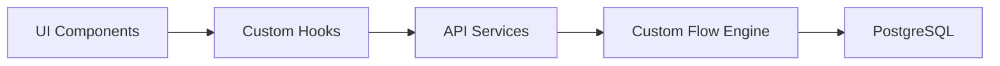

# Case Management Application

A production-ready, reusable Case Management application for the NEWWORK Gravity Platform. This application provides comprehensive case lifecycle management with flow tracking, entity linking, and analytics.

## Features

- Dashboard with real-time analytics and KPIs
- Case list with advanced filtering and search
- Detailed case views with tabbed interface
- Flow management (add/remove flows to cases)
- Entity linking (users, employees, organizational units)
- Notes and comments timeline
- Tag-based filtering for module isolation
- Auto-refresh for real-time updates
- Full CRUD operations
- Production-ready with proper error handling

## Installation

The application is located at:

```
src/business-apps/common/apps/case-management/
```

## Usage

### Basic Usage

```tsx
import { CaseManagement } from '@/business-apps/common/apps/case-management'

const MyApp = () => {
  const context = {
    accessToken: 'your-access-token',
    userInfo: { id: 'user123', name: 'John Doe' }
  }

  return (
    <CaseManagement
      appName="HR Cases"
      appDescription="Manage employee lifecycle and HR-related cases"
      appTag="AppCatalog:1:HR"
      {...context}
    />
  )
}
```

### Props Configuration

#### Required Props

| Prop          | Type     | Description                                              |
| ------------- | -------- | -------------------------------------------------------- |
| `appName`     | `string` | Display name for the application (e.g., "HR Cases")      |
| `appTag`      | `string` | Tag filter for isolating cases (e.g., "AppCatalog:1:HR") |
| `accessToken` | `string` | JWT access token for API authentication                  |

#### Optional Props

| Prop                  | Type                    | Default                                      | Description                         |
| --------------------- | ----------------------- | -------------------------------------------- | ----------------------------------- |
| `appDescription`      | `string`                | `undefined`                                  | Description text shown in dashboard |
| `allowCreate`         | `boolean`               | `true`                                       | Enable case creation                |
| `allowEdit`           | `boolean`               | `true`                                       | Enable case editing                 |
| `allowDelete`         | `boolean`               | `false`                                      | Enable case deletion                |
| `showAnalytics`       | `boolean`               | `true`                                       | Show dashboard analytics            |
| `defaultView`         | `'dashboard' \| 'list'` | `'dashboard'`                                | Default view on load                |
| `enableEntityLinking` | `boolean`               | `true`                                       | Enable entity linking               |
| `entityTypes`         | `array`                 | `['user', 'employee', 'organizationalUnit']` | Entity types available for linking  |
| `columns`             | `CaseColumnConfig[]`    | `undefined`                                  | Custom column configuration         |
| `statusOptions`       | `StatusOption[]`        | `undefined`                                  | Custom status definitions           |

### Module-Specific Examples

#### HR Module

```tsx
<CaseManagement
  appName="HR Cases"
  appDescription="Employee lifecycle and HR service cases"
  appTag="AppCatalog:1:HR"
  entityTypes={['employee', 'organizationalUnit']}
  {...context}
/>
```

#### Service Desk

```tsx
<CaseManagement
  appName="Service Cases"
  appDescription="IT and business service request cases"
  appTag="AppCatalog:1:SVC"
  allowDelete={false}
  {...context}
/>
```

#### Finance Module

```tsx
<CaseManagement
  appName="Finance Cases"
  appDescription="Financial approval and audit cases"
  appTag="AppCatalog:1:FIN"
  entityTypes={['user', 'organizationalUnit']}
  defaultView="list"
  {...context}
/>
```

#### Platform Admin (All Cases)

```tsx
<CaseManagement
  appName="All Cases"
  appDescription="Organization-wide case management"
  appTag="*" // Show all cases
  showAnalytics={true}
  {...context}
/>
```

## Architecture

### Component Structure

```
CaseManagement (Main)
├── CaseDashboard (Dashboard view)
│   ├── KPI Cards
│   ├── Quick Actions
│   └── Recent Cases List
├── CaseList (List view)
│   ├── DataDisplay
│   ├── DataTable
│   └── FilterSheet
└── CaseDetails (Detail view)
    ├── RecordLayout
    ├── Overview Tab
    ├── Flows Tab (FlowManagementPanel)
    ├── Notes Tab (CaseNotesPanel)
    └── Links Tab (EntityLinkingPanel)
```

### Data Flow



### Custom Hooks

- `useCaseData` - Fetches case data with auto-refresh
- `useCaseFilters` - Manages filter state with URL sync
- `useCaseAnalytics` - Fetches analytics and KPIs
- `useEntityLinking` - Handles entity search and linking

### Services

- `CaseApiClient` - REST API client for Cases endpoints

## API Integration

### Custom Flow Engine Endpoints

The application integrates with these backend endpoints:

- `POST /api/cases` - Create case
- `GET /api/cases/:caseId` - Get case details
- `POST /api/cases/:caseId/flows` - Add flow to case
- `DELETE /api/cases/:caseId/flows/:workflowId` - Remove flow from case
- `POST /api/cases/:caseId/complete` - Complete case
- `GET /api/cases/:caseId/flows` - Get linked flows

### Environment Variables

```bash
REACT_APP_FLOW_ENGINE_BASE_URL=/flow-engine
REACT_APP_ORG_DIRECTORY_BASE_URL=/org-directory
```

## Tag-Based Filtering

Cases are automatically filtered by the `appTag` prop. This ensures that:

- HR module only sees HR cases
- Service Desk only sees service cases
- Finance only sees finance cases
- Platform admin can see all cases with `appTag="*"`

Tags are applied automatically when creating cases and querying case lists.

## Features

### 1. Dashboard

- Real-time KPI metrics
- Quick action cards
- Recent cases list
- Navigation to create/view cases

### 2. Case List

- DataTable with sorting and pagination
- Advanced filtering:
  - Status (multi-select)
  - Priority
  - Assigned to
  - Date range
- Search by title, description, or ID
- Bulk actions (future)
- Row actions (view, complete, delete)

### 3. Case Details

**Overview Tab:**

- Case metadata and information
- Status, priority, assignments
- Created/due dates

**Flows Tab:**

- Linked flows with real-time status
- Add new flows from templates
- Remove/unlink flows
- Terminal state validation
- Blocking flows warning

**Notes Tab:**

- Timeline of notes/comments
- Add new notes
- Internal/external visibility
- Edit/delete own notes

**Links Tab:**

- Linked entities (users, employees, org units)
- Search and link new entities
- Unlink entities
- Entity details display

### 4. Auto-Refresh

- Case details refresh every 30 seconds
- Real-time flow status updates
- Ensures data consistency

### 5. Terminal State Validation

- Cases can only be completed when all active flows are terminal
- Terminal states: COMPLETED, FAILED, TERMINATED, TIMED_OUT, CANCELED, SKIPPED
- Blocking flows are clearly indicated
- Validation enforced by backend

## Design System

All components use `@newwork/nw-design-system`:

- `LauncherLayout` - Dashboard layout
- `RecordLayout` - Detail view layout
- `DataDisplay` - List view with filtering
- `DataTable` - Data table with sorting/pagination
- `Form` - Form components with validation
- `Dialog`, `Sheet`, `AlertDialog` - Modals
- `Card`, `Badge`, `Button` - UI primitives
- `Timeline` - Notes timeline
- `Combobox` - Entity search

## Architectural Patterns

Follows gravity-business-apps conventions:

1. **Context Props**: Receives `BusinessAppContextProps` with auth and user info
2. **Hook-Based Data**: Custom hooks encapsulate data fetching
3. **Service Layer**: API clients handle backend communication
4. **URL State**: View state synced with URL parameters
5. **Tag Filtering**: Automatic app-scoped filtering
6. **Error Handling**: Graceful error handling with user feedback
7. **Type Safety**: Full TypeScript coverage

## Development

### Adding New Fields to Case Metadata

1. Update `CaseMetadata` interface in `types/case.types.ts`
2. Update `CaseForm.tsx` to include new field
3. Update `CaseDetails.tsx` overview tab
4. Update API client if backend changes needed

### Customizing Columns

```tsx
<CaseManagement
  columns={[
    { key: 'caseId', label: 'ID', visible: true, sortable: true },
    { key: 'title', label: 'Title', visible: true, sortable: true },
    { key: 'customField', label: 'Custom', visible: true, sortable: false }
  ]}
  {...context}
/>
```

### Customizing Status Options

```tsx
<CaseManagement
  statusOptions={[
    { value: 'open', label: 'Open', color: 'blue' },
    { value: 'custom_status', label: 'Custom', color: 'purple' }
  ]}
  {...context}
/>
```

## Testing

### Manual Testing

1. Start the custom-flow-engine backend
2. Start the gravity-business-apps frontend
3. Navigate to the module using the case management app
4. Test case creation, viewing, and flow management

### Integration Testing

```tsx
// Example test
import { render, screen } from '@testing-library/react'
import { CaseManagement } from './CaseManagement'

test('renders case management dashboard', () => {
  const context = {
    accessToken: 'test-token',
    userInfo: { id: 'test-user' }
  }

  render(<CaseManagement appName="Test Cases" appTag="test" {...context} />)

  expect(screen.getByText('Dashboard')).toBeInTheDocument()
})
```

## Future Enhancements

- Child case relationships
- SLA tracking and alerts
- Advanced analytics with charts
- Bulk operations
- Real-time notifications
- Export functionality
- Case templates
- Mobile responsive optimization
- Accessibility audit (WCAG 2.1 AA)

## Support

For issues or questions, refer to:

- [Custom Flow Engine API Documentation](http://localhost:3000/api-docs)
- [NEWWORK Design System](../../../../../nw-design-system/README.md)
- Gravity Business Apps Architecture Documentation

## License

Internal NEWWORK application - All rights reserved
