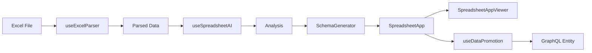

# Spreadsheet Apps - Excel-to-App Generator

Transform Excel files into instant, fully functional business applications with AI-powered analysis.

## Overview

The Spreadsheet Apps module allows users to:

1. **Upload** any Excel file (.xlsx, .xls, .csv)
2. **Analyze** with AI to detect column types, relationships, and suggest app structure
3. **Generate** instant apps with table, form, dashboard, and kanban views
4. **Customize** with a visual low-code editor
5. **Promote** to a real database when ready

## Features

### AI-Powered Analysis

- Automatic column type detection (text, number, date, email, currency, etc.)
- Relationship detection between sheets
- App structure recommendations based on data patterns
- Business purpose inference

### Multiple View Types

- **Table View**: Sortable, filterable data grid with inline editing
- **Form View**: Card-based record display with add/edit forms
- **Dashboard View**: KPIs and charts based on numeric columns
- **Kanban View**: Column-based board for status-driven data
- **Calendar View**: Date-based timeline (coming soon)

### Low-Code Editor

- Drag-and-drop column reordering
- Column type configuration
- Validation rules
- View management
- Sheet settings (add/edit/delete permissions)

### Database Promotion

- Convert file-based apps to GraphQL entities
- Full API access after promotion
- Data migration with validation

## Quick Start

```tsx
import { SpreadsheetAppsHub } from '@/business-apps/platform/apps/spreadsheet-apps'

const MyComponent = () => {
  return (
    <SpreadsheetAppsHub
      accessToken={accessToken}
      userInfo={userInfo}
    />
  )
}
```

## Components

| Component | Description |
|-----------|-------------|
| `SpreadsheetAppsHub` | Main entry point - upload and manage apps |
| `SpreadsheetAppViewer` | Runtime viewer for generated apps |
| `SpreadsheetAppEditor` | Visual low-code editor |
| `ExcelUploader` | Drag-drop file upload component |
| `SheetAnalysisPreview` | AI analysis results preview |
| `AppPreviewCard` | App card for the apps list |
| `ColumnTypeEditor` | Column configuration dialog |
| `PromoteToDatabaseModal` | Database promotion wizard |

## Hooks

| Hook | Description |
|------|-------------|
| `useExcelParser` | Parse Excel files with SheetJS |
| `useSpreadsheetAI` | AI-powered spreadsheet analysis |
| `useSpreadsheetApps` | CRUD operations for apps |
| `useDataPromotion` | Database promotion logic |

## Types

Key types are defined in `types/spreadsheet.ts`:

- `SpreadsheetApp` - Complete app definition
- `SpreadsheetSheet` - Sheet with columns, views, and data
- `SpreadsheetColumn` - Column definition with type and validation
- `SpreadsheetAnalysis` - AI analysis result
- `SheetView` - View configuration (table, form, dashboard, etc.)

## Architecture

```
spreadsheet-apps/
├── SpreadsheetAppsHub.tsx      # Main hub component
├── SpreadsheetAppViewer.tsx    # App runtime viewer
├── SpreadsheetAppEditor.tsx    # Low-code editor
├── components/                 # Reusable components
│   ├── ExcelUploader.tsx
│   ├── SheetAnalysisPreview.tsx
│   ├── AppPreviewCard.tsx
│   ├── ColumnTypeEditor.tsx
│   └── PromoteToDatabaseModal.tsx
├── hooks/                      # Custom hooks
│   ├── useExcelParser.ts
│   ├── useSpreadsheetAI.ts
│   ├── useSpreadsheetApps.ts
│   └── useDataPromotion.ts
├── services/                   # Business logic
│   ├── SpreadsheetAppService.ts
│   └── SchemaGenerator.ts
├── prompts/                    # AI prompts
│   └── spreadsheet-analyzer.ts
└── types/                      # TypeScript types
    └── spreadsheet.ts
```

## Data Flow



## Dependencies

- `xlsx` (SheetJS) - Excel parsing
- `@newwork/nw-design-system` - UI components
- Prompt Manager - AI integration

## Storage

- Apps are stored in localStorage by default
- Use `useDataPromotion` to migrate to GraphQL backend
- Promoted apps use the standard GraphQL entity system

## Best Practices

1. **File Size**: Keep Excel files under 10MB for best performance
2. **Column Names**: Use descriptive headers - AI uses them for type detection
3. **Data Quality**: Clean data before upload for better analysis
4. **Relationships**: Use consistent naming (e.g., `customer_id`) for FK detection

## Future Enhancements

- [ ] Calendar view implementation
- [ ] Chart widget builder
- [ ] Workflow integration (notify on row add)
- [ ] Multi-user collaboration
- [ ] Version history
- [ ] Template library
